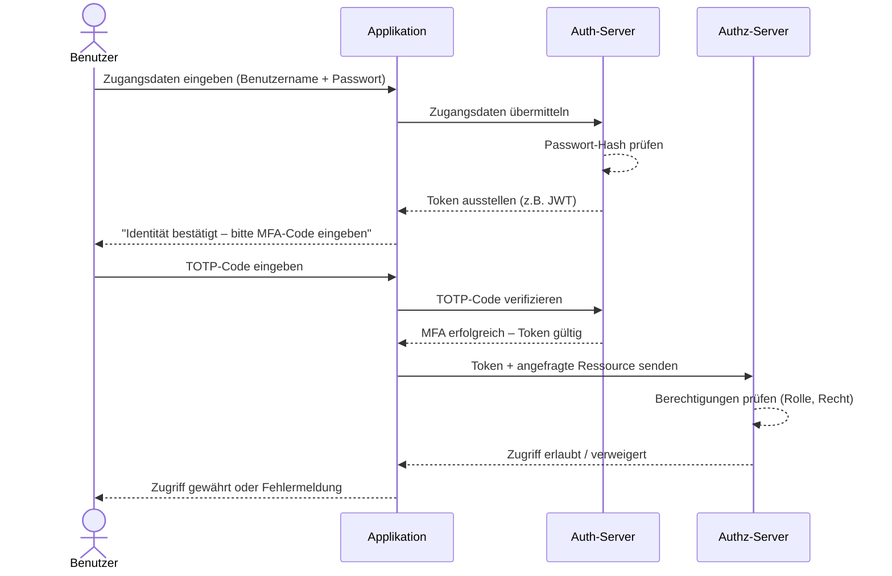
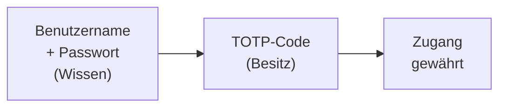
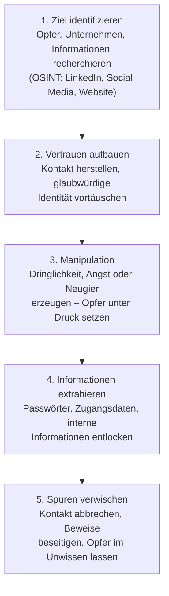

# Tag 01 - Modulstart, Authentifizierung & Autorisierung, Social Engineering

  

	Block: Einführung (~25')
  

## Plenum

Besprechung und Vertiefung der Kompetenzmatrix aus dem Modulbaukasten M231:

Wo, Wann, Was?
- Semesterplan / Lektionsplan
- Kompetenzmatrix: [Modul 231 im Modulbaukasten der ICT-Berufsbildung](https://www.modulbaukasten.ch/module/231/1/de-DE?title=Datenschutz-und-Datensicherheit-anwenden&tab=2&degree=13d8d40b-6d82-eb11-a812-0022486f6f83)
- Leistungsbeurteilung (LB1, LB2, LB3)
- Vorstellrunde falls Q1
- Arbeitsmethoden einführen: Dateiablage, Git-Repository, Lernjournal, Leistungsbeurteilung
- **KI-Nutzungsrahmen** (siehe [README](README.md#ki-nutzungsrahmen)): KI ist in diesem Modul als Lernpartner erlaubt und erwünscht — mehr dazu im letzten Block dieses Tages

### Modulüberblick: Die 10 Kurstage

Das folgende Diagramm zeigt die Lernreise durch das gesamte Modul M231. Jeder Tag baut auf dem vorherigen auf.

```mermaid
flowchart LR
  T1["Tag 1\nModulstart\nAuth & Authz\nSocial Eng."]
  T2["Tag 2\nGit/Markdown\nDatenschutzrecht\nDSG/DSGVO"]
  T3["Tag 3\nCIA-Triade\nOnline-Anonymität"]
  T4["Tag 4\nLizenzmodelle\nPrivacy-Threats\nDark Patterns"]
  T5["Tag 5\nLB1-Theorieprüfung"]
  T6["Tag 6\nChecklisten DSB\nVerschlüsselung sym."]
  T7["Tag 7\nVerschlüsselung asym.\nDateiablage"]
  T8["Tag 8\nCIA-Prinzip\nRisiko & PGP"]
  T9["Tag 9\nLB2, LB3-Abgabe\nGit im Team\nRansomware, Backup"]
  T10["Tag 10\nNachschreiben LB2\nModulabschluss"]

  T1 --> T2 --> T3 --> T4 --> T5 --> T6 --> T7 --> T8 --> T9 --> T10
```

> **Leistungsbeurteilungen:**
> - **LB1** (Theorieprüfung am Computer, Safe Exam Browser, Tag 5, keine Hilfsmittel): Theoriefragen zu Stoff Tag 1–4 – Auth/Authz, Social Engineering, Datenschutzrecht, CIA-Triade, Online-Anonymität, Lizenzen, Privacy-Threats
> - **LB2** (Theorieprüfung am Computer, Safe Exam Browser, Tag 9, persönlicher Spick 1 A4 doppelseitig): Theoriefragen zu Verschlüsselung, CIA-Prinzip, Risiko, Dateiablage (Schwerpunkt Tag 6–8) sowie Repetition Tag 1–4; Tag 10 ist für das Nachschreiben reserviert
> - **LB3** (Portfolio, Abgabe Tag 9): Git-Repository mit Aufträgen und Reflexionen

  

	Block: Safe Exam Browser einrichten (~10')
  

> Sozialform: Einzelarbeit
> Dauer: 10min
> Abgabe: Test «SEB-Test» in Moodle

LB1 und LB2 schreiben Sie in Moodle mit dem **Safe Exam Browser**. Er sperrt während der Prüfung alle
anderen Programme. Richten Sie ihn heute ein, damit er am Prüfungstag sicher läuft.

1. Laden Sie den Safe Exam Browser für Ihr System herunter und installieren Sie ihn:
   [safeexambrowser.org/download_en.html](https://safeexambrowser.org/download_en.html)
   (Windows: Installer ausführen · macOS: App in den Ordner «Programme» ziehen · iPad: App Store)
2. Speichern Sie offene Arbeit. Der Safe Exam Browser kann beim Start andere Programme schliessen.
3. Öffnen Sie in Ihrem normalen Browser den Moodle-Test
   [SEB-Test – Safe Exam Browser prüfen](https://moodle.edu.zh.ch/mod/quiz/view.php?id=22406).
4. Starten Sie dort den Safe Exam Browser über den Knopf auf der Testseite. Klappt das nicht, laden Sie
   mit «Konfiguration herunterladen» die Datei herunter und öffnen Sie sie.
5. Melden Sie sich im Safe Exam Browser bei Moodle an, beantworten Sie die eine Frage und geben Sie den
   Test ab.
6. Beenden Sie den Safe Exam Browser über den Knopf zum Beenden unten rechts.

> Sie arbeiten mit **Linux**, haben **keine Adminrechte** oder der Safe Exam Browser startet nicht?
> Melden Sie sich **heute** bei der Lehrperson, nicht erst am Prüfungstag.

  

	Block: Lernjournal, Erwartungen & Befürchtungen (~30')
  

> Sozialform: Einzelarbeit
> Dauer: 20min
> Abgabe: MS-Teams Assignment

### Teil 1
Setzen Sie ihr Lernjournal auf (z. B. als Seite in Ihrem persönlichen Git-Repository) und geben Sie es der Lehrperson frei: GitLab **`@nfricker`** · GitHub **`nicolaifrickertbz`**. Legen Sie den Link am gewünschten Ort ab.
- Starten Sie mit einer Struktur, zum Beispiel:
    - Tagesjournal mit folgenden Fragen:
        - Was habe ich heute gemacht?
        - Was habe ich heute gelernt?
        - Was hat funktioniert (Methode)?
        - Was würde ich für das nächste Mal anders machen?
    - Modelle & erlernte Inhalte (eigene Zusammenfassungen)

---

### Teil 2
1. Meine **Erwartungen** an dieses Modul sind …
    - Welche Kompetenzen möchte ich aufbauen (fachlich + methodisch)?
    - Was möchte ich am Ende konkret anwenden können?

2. So wünsche ich mir die **Arbeit mit SOL** (Selbstorganisiertes Lernen) …
    - Was brauche ich, damit ich effizient arbeiten kann?
    - Wie plane ich mein Vorgehen (Ziele, Zwischensteps, Zeitmanagement)?

3. Meine **Befürchtungen / Herausforderungen** in diesem Modul sind …
    - Was könnte mich ausbremsen?
    - Woran merke ich früh, dass ich Unterstützung brauche?

---

### Teil 3
Tauschen Sie sich zu Teil 2 mit dem Pultnachbar aus.

  

	Block: Authentifizierung & Autorisierung (~40')
  

## Authentifizierung vs. Autorisierung

> 🤖 **Copilot-Agent:** [M231 T01a Authentifizierung](https://m365.cloud.microsoft/chat/?titleId=T_dd22b379-ff54-cde3-f403-a1d79966cbf4&source=embedded-builder) — mit dem TBZ-Konto öffnen und **Start** tippen.

### Begriffe

| Begriff | Definition | Frage |
|---|---|---|
| **Authentifizierung** | Nachweis der Identität | Wer bist du? |
| **Autorisierung** | Vergabe von Rechten und Berechtigungen | Was darfst du tun? |

> **Merksatz:** Erst *authentifizieren*, dann *autorisieren*.

---

### Der vollständige Login-Ablauf

Das folgende Sequenzdiagramm zeigt, wie Authentifizierung und Autorisierung in einem modernen System zusammenspielen:

---

### Faktoren der Authentifizierung

| Faktor | Kategorie | Beispiel |
|---|---|---|
| Wissen | Something you **know** | Passwort, PIN, Antwort auf Sicherheitsfrage |
| Besitz | Something you **have** | Smartphone (TOTP-App), Hardware-Token, Smartcard |
| Biometrie | Something you **are** | Fingerabdruck, Gesichtserkennung, Iris-Scan |

---

### Multi-Faktor-Authentifizierung (MFA)

MFA kombiniert **mindestens zwei verschiedene Faktoren**. Dadurch reicht ein gestohlenes Passwort alleine nicht mehr aus.

**Vergleich der gängigen MFA-Methoden:**

| Methode | Sicherheit | Benutzerfreundlichkeit | Kosten | Risiko |
|---|:---:|:---:|:---:|---|
| **SMS-Code** | Mittel | Hoch | Gering | SIM-Swapping, SS7-Angriffe |
| **TOTP-App** (Authy, Google Auth) | Hoch | Mittel | Gering | Geräteverlust, Phishing möglich |
| **Hardware-Token** (YubiKey) | Sehr hoch | Mittel | Mittel-hoch | Physischer Verlust |
| **Push-Benachrichtigung** | Hoch | Hoch | Gering | MFA-Fatigue-Angriffe |
| **Biometrie** (Fingerabdruck) | Hoch | Sehr hoch | Im Gerät integriert | Biometrische Daten unveränderbar |

> **MFA-Fatigue:** Angreifer senden massenhaft Push-Anfragen, bis der Nutzer aus Versehen bestätigt. Gegenmassnahme: Zahlenkodierung (Nummerierter Push-Code).

---

### Zugriffskonzepte

**Prinzip der minimalen Rechte (Least Privilege):**
> Jede Person erhält nur die Rechte, die sie für ihre Aufgabe tatsächlich braucht.

**Rollen und Berechtigungen:**

| Rolle | Kann lesen | Kann schreiben | Kann löschen | Kann Benutzer verwalten |
|---|:---:|:---:|:---:|:---:|
| Gast | ✓ | — | — | — |
| Benutzer | ✓ | ✓ | — | — |
| Admin | ✓ | ✓ | ✓ | ✓ |

---

### Transferaufgabe

> Sozialform: Partnerarbeit
> Dauer: 5min PA, 5min PL
> Abgabe: Plenum

Sie verwalten die IT-Infrastruktur einer kleinen Firma (20 Mitarbeitende, 3 Abteilungen: Verkauf, Buchhaltung, IT).

1. Welche MFA-Methode empfehlen Sie – und warum?
2. Welche Zugriffsrechte würden Sie der Buchhaltung auf den Finanzserver geben?
3. Was passiert, wenn das Least-Privilege-Prinzip verletzt wird?

  

	Block: Social Engineering & Passwortsicherheit (~40')
  

## Social Engineering

> 🤖 **Copilot-Agent:** [M231 T01b Social Engineering](https://m365.cloud.microsoft/chat/?titleId=T_bf5f2628-c443-a8c2-e0e8-070510f3090c&source=embedded-builder) — mit dem TBZ-Konto öffnen und **Start** tippen.

Social Engineering bezeichnet das **gezielte Manipulieren von Menschen**, um vertrauliche Informationen zu erhalten oder Handlungen auszulösen – ohne technische Angriffe.

### Die Angriffskette

Social-Engineering-Angriffe folgen einem wiederkehrenden Muster:

---

### Häufige Angriffsmethoden

| Methode | Beschreibung | Erkennungsmerkmal |
|---|---|---|
| **Phishing** | Gefälschte E-Mails/Webseiten die Zugangsdaten stehlen | Dringlichkeit, unbekannter Absender, Link-Prüfung |
| **Spear Phishing** | Gezieltes Phishing auf bestimmte Person/Firma | Persönliche Details, wirkt sehr echt |
| **Vishing** | Betrug per Telefonanruf | Anrufer gibt sich als Bank/IT-Support aus |
| **Pretexting** | Vortäuschen einer falschen Identität oder Situation | Erfundene Szenarien (z. B. „IT-Notfall") |
| **Baiting** | Verlockung durch gefundenes USB-Stick o.ä. | Neugier wird ausgenutzt |

---

### Passwortsicherheit

**Was macht ein Passwort sicher?**
- Länge: mindestens **12 Zeichen** (besser 16+)
- Komplexität: Gross- und Kleinbuchstaben, Ziffern, Sonderzeichen
- Einzigartigkeit: **Kein Passwort doppelt verwenden**
- Keine persönlichen Infos (Name, Geburtstag, Lieblingsverein)

**Passwort-Entropie:**

| Länge | Zeichensatz | Mögliche Kombinationen |
|---:|---|---|
| 8 | Kleinbuchstaben (26) | 26⁸ ≈ 200 Mrd. |
| 12 | Alphanumerisch (62) | 62¹² ≈ 3,2 × 10²¹ |
| 20 | Alle druckbaren (94) | 94²⁰ ≈ 5,6 × 10³⁹ |

**Passphrasen:**
> Eine Folge von zufälligen Wörtern ist lang UND merkbar.
> Beispiel: `Kiwi-Balkon-Torte-7-Mond`

---

### Passwort-Manager

Da es unmöglich ist, für jeden Dienst ein einzigartiges, starkes Passwort auswendig zu kennen, ist ein **Passwort-Manager** die empfohlene Lösung.

**Wie funktioniert ein Passwort-Manager?**
- Alle Passwörter werden in einem verschlüsselten Tresor gespeichert
- Zugang nur über ein einziges **Master-Passwort** (oder Biometrie)
- Passwörter werden automatisch ausgefüllt (Schutz gegen Keylogger)
- Viele Manager erkennen gefälschte Webseiten (kein Autofill bei falscher URL)

**Vergleich populärer Passwort-Manager:**

| Tool | Typ | Speicherort | Kosten | Besonderheit |
|---|---|---|---|---|
| **Bitwarden** | Open Source | Cloud (verschlüsselt) | Gratis / Premium | Empfehlung für Einsteiger |
| **KeePassXC** | Open Source | Lokal (Datei) | Gratis | Volle Kontrolle, kein Cloud-Zwang |
| **1Password** | Proprietär | Cloud | ~3 CHF/Mt. | Sehr gute UX, Familienplan |
| **ProtonPass** | Open Source | Cloud (Proton) | Gratis / Plus | Integriert in Proton-Ökosystem |

> **Wichtig:** Der Passwort-Manager selbst muss mit einem sehr starken Master-Passwort und MFA geschützt werden.

---

### Schutzmassnahmen gegen Social Engineering

1. **Skepsis** bei unerwarteten Anfragen (Dringlichkeit = Warnsignal)
2. **Identität verifizieren** – zurückrufen auf bekannte Nummer
3. **Keine Passwörter** telefonisch oder per Mail weitergeben
4. **Meldewege** kennen: Was tue ich, wenn ich eine Phishing-Mail erhalte?

---

### Transferaufgabe: Phishing erkennen

> Sozialform: Einzelarbeit
> Dauer: 10min
> Abgabe: Plenum

Analysieren Sie die folgende (fiktive) E-Mail und identifizieren Sie mindestens 3 Warnsignale:

> **Von:** support@postfinance-sicherheit.ch
> **Betreff:** ⚠️ DRINGEND: Ihr Konto wird in 24h gesperrt!
> **Text:** Sehr geehrte/r Kunde/in, aufgrund verdächtiger Aktivitäten müssen Sie Ihre Daten sofort bestätigen. Klicken Sie hier: [www.postfinance-login-update.com]

  

	Block: KI-Werkstatt 1 – Spielregeln & NotebookLM ausprobieren (~20')
  

## KI als Lernpartner im Modul M231

In diesem Modul dürfen Sie KI-Werkzeuge (z. B. ChatGPT, Claude, Copilot) gezielt als **Lernpartner** nutzen — mit klaren Leitplanken. Den vollständigen Nutzungsrahmen finden Sie im [README](README.md#ki-nutzungsrahmen). Kurzfassung:

| Erlaubt | Nicht erlaubt |
|---|---|
| Erklärungen einfordern, Rückfragen stellen | Lernjournal-Reflexionen von der KI schreiben lassen |
| Prompt-Übungen, Testdaten/Übungsbeispiele generieren | Prüfungsantworten (LB1/LB2 sind ohne elektronische Hilfsmittel) |
| Recherche-Einstieg, Konzepte erklären lassen | Eigenleistungspflichtige Kernaufgaben (z. B. Chiffren von Hand knacken, GPG-Setup) ersetzen |

> **Rolle der KI:** sokratischer Tutor/Coach – gibt Hinweise und Rückfragen, keine fertigen Lösungen.

---

### Transferaufgabe: Erste Schritte mit NotebookLM

> Sozialform: Einzelarbeit
> Dauer: 20min
> Abgabe: Plenum (kurzer Austausch)

1. Öffnen Sie [NotebookLM](https://notebooklm.google.com) und erstellen Sie ein neues Notizbuch für M231.
2. Fügen Sie als Quelle **explizit den heutigen Tag** hinzu: *Quelle hinzufügen → Link/Website* → [tag-01.md](tag-01.md) (lässt sich der Link nicht laden, fügen Sie den Inhalt der Seite alternativ als Text ein).
3. Lassen Sie NotebookLM aus dieser Quelle **Karteikarten** zum heutigen Stoff erstellen (Studienhilfen → Karteikarten) und beantworten Sie mindestens 5 davon.
4. Starten Sie zusätzlich eine **Audio-Übersicht (Podcast)** zur heutigen Quelle. Die Erstellung läuft im Hintergrund – Sie können währenddessen mit den Karteikarten weiterarbeiten.
5. Installieren Sie die NotebookLM-App auf Ihrem Smartphone (iOS/Android), melden Sie sich an und öffnen Sie dort dasselbe Notizbuch. Hören Sie kurz in den Podcast hinein bzw. lösen Sie dort ein paar Karteikarten.
6. Halten Sie in 1–2 Sätzen fest: Waren Karteikarten und Podcast inhaltlich korrekt? Was hat NotebookLM gut zusammengefasst, was eher oberflächlich oder falsch?

*(Optional, nicht bewertet: Sie können diese Beobachtung informell in Ihr Lernjournal aufnehmen.)*

