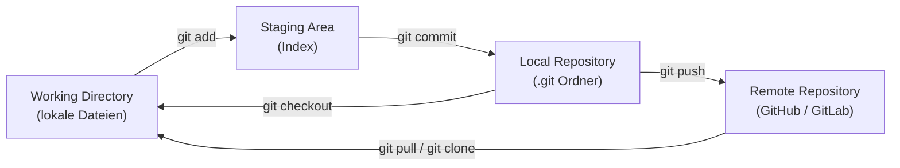
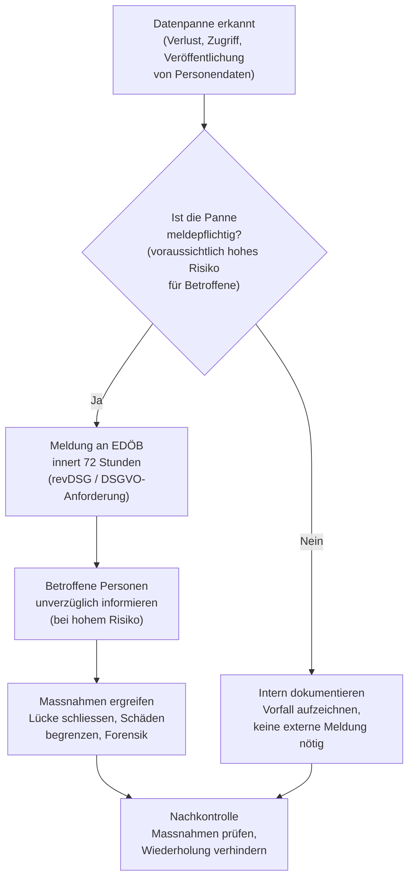

# Tag 02 - Werkzeuge & Datenschutzrecht

<details>
  <summary>
	Block: Repetition Tag 1 (~10')
  </summary>

## Repetitionsblock: Was ist von Tag 1 hängen geblieben?

> Sozialform: Einzelarbeit im Plenum (Fragen werden gemeinsam vorgelesen/gezeigt, jede:r beantwortet für sich)
> Dauer: 10min (ca. 6min stilles Beantworten, 4min gemeinsame Auswertung)
> Abgabe: mündlich im Plenum

Beantworten Sie die folgenden 6 Fragen still für sich (auf Papier oder im Lernjournal-Entwurf). Anschliessend werden die Fragen im Plenum reihum aufgelöst.

**Frage 1:** Was ist der Unterschied zwischen Authentifizierung und Autorisierung? Nennen Sie je ein Beispiel.

<details>
  <summary>Lösungshinweis</summary>

Authentifizierung prüft, *wer* jemand ist (z. B. Login mit Passwort). Autorisierung legt fest, *was* diese Person darf (z. B. Zugriff auf bestimmte Ordner). Authentifizierung kommt immer zuerst.

</details>

**Frage 2:** Nennen Sie die drei Faktorenkategorien der Authentifizierung und je ein Beispiel dazu.

<details>
  <summary>Lösungshinweis</summary>

Wissen (z. B. Passwort), Besitz (z. B. Hardware-Token, Smartphone), Biometrie (z. B. Fingerabdruck). MFA kombiniert mindestens zwei *verschiedene* Kategorien.

</details>

**Frage 3:** Was bedeutet das Prinzip "Least Privilege" und warum ist es wichtig?

<details>
  <summary>Lösungshinweis</summary>

Nutzer:innen erhalten nur genau die Rechte, die sie für ihre Aufgabe brauchen – nicht mehr. Das begrenzt den Schaden, falls ein Konto kompromittiert wird oder jemand fahrlässig/böswillig handelt.

</details>

**Frage 4:** Nennen Sie zwei Methoden des Social Engineering und worin sie sich unterscheiden.

<details>
  <summary>Lösungshinweis</summary>

Z. B. Phishing (E-Mail mit gefälschtem Absender/Link) vs. Vishing (Voice Phishing, telefonisch). Beide zielen auf Manipulation und Vertrauensmissbrauch, unterscheiden sich aber im Kanal.

</details>

**Frage 5:** Was macht ein sicheres Passwort aus, und wofür braucht man einen Passwort-Manager?

<details>
  <summary>Lösungshinweis</summary>

Sicher = lang (Passphrase statt kurzes komplexes Passwort), einzigartig pro Dienst, keine offensichtlichen Muster. Ein Passwort-Manager generiert und speichert einzigartige, komplexe Passwörter pro Dienst, sodass man sich nur ein Master-Passwort merken muss.

</details>

**Frage 6:** Wie darf KI gemäss dem KI-Nutzungsrahmen in diesem Modul genutzt werden? Nennen Sie ein Beispiel für "erlaubt" und eines für "nicht erlaubt".

<details>
  <summary>Lösungshinweis</summary>

Erlaubt: Erklärungen einfordern, Rückfragen stellen, Prompt-Übungen/Testdaten generieren lassen. Nicht erlaubt: Lernjournal-Reflexionen von der KI schreiben lassen, KI bei LB1/LB2 nutzen, eigenleistungspflichtige Kernaufgaben durch KI ersetzen.

</details>

</details>


<details>
  <summary>
	Block: Einführung Git/Markdown & LB3 (~35')
  </summary>

→ **[LB3 – Auftrag & Bewertungsraster](lbs/lb3/lb3-auftrag.md)**

### Der Git-Workflow

> 🤖 **Copilot-Agent:** [M231 T02a Git & Markdown](https://m365.cloud.microsoft/chat/?titleId=T_24e32efa-32ba-1462-2a58-03127fa5ff11&source=embedded-builder) — mit dem TBZ-Konto öffnen und **Start** tippen.

Git verwaltet Änderungen an Dateien in mehreren Schichten. Das folgende Diagramm zeigt den grundlegenden Arbeitsablauf:



**Wichtigste Git-Befehle im Überblick:**

| Befehl | Wirkung |
|---|---|
| `git init` | Neues Repository initialisieren |
| `git status` | Zeigt den aktuellen Zustand (geänderte, gestagete Dateien) |
| `git add <datei>` | Datei zur Staging Area hinzufügen |
| `git commit -m "Nachricht"` | Änderungen als Snapshot speichern |
| `git push` | Lokale Commits ins Remote-Repo hochladen |
| `git pull` | Änderungen vom Remote-Repo herunterladen |
| `git log` | Commit-Historie anzeigen |

---

### Mermaid-Challenge: Spaghetti kochen als Flowchart

> Sozialform: Gruppenarbeit (3–4 Personen)
> Dauer: 10min
> Abgabe: Link zur Datei, Vorstellung/Prämierung im Verlauf des Tages

Das Git-Repository haben Sie bereits an Tag 1 für Ihr Lernjournal erstellt und der Lehrperson freigegeben. Sie haben oben im Git-Workflow-Diagramm gesehen, wie ein Ablauf als Mermaid-Flowchart dargestellt wird – jetzt sind Sie dran!

**Mermaid-Flowchart – die wichtigsten Elemente:**

| Element | Syntax | Bedeutung |
|---|---|---|
| Diagrammblock | ` ```mermaid ` … ` ``` ` | Kennzeichnet den Diagrammcode |
| Richtung | `flowchart TD` / `flowchart LR` | Top-Down bzw. Left-Right |
| Schritt (Rechteck) | `A["Text"]` | normaler Prozessschritt |
| Entscheidung (Raute) | `B{"Frage?"}` | Verzweigung |
| Pfeil | `A --> B` | Ablauf |
| Beschrifteter Pfeil | `A -- "Ja" --> C` | Ablauf mit Bedingung |

1. Bilden Sie eine Gruppe von 3–4 Personen (nach Sitzordnung).
2. Modellieren Sie gemeinsam den Prozess **«Spaghetti kochen»** als Flowchart – mit **mindestens einer Entscheidung/Verzweigung** (z. B. «Wasser am Kochen?», «Spaghetti al dente?», «Sauce fertig?»). Alle Gruppen bearbeiten denselben Prozess – das macht die Diagramme direkt vergleichbar.
3. Entwerft und prüft euer Diagramm im Online-Editor **[mermaid.live](https://mermaid.live/)** – dort seht ihr die Grafik live, ohne committen zu müssen.
4. Legt in **eurem persönlichen Git-Repository** (aus Tag 1) eine neue Datei `mermaid-challenge.md` an und fügt den fertigen Code aus mermaid.live ein – am schnellsten direkt über «Add file» im Browser auf GitHub/GitLab, ohne lokales Klonen.
5. Committet die Datei und gebt den Link im Klassen-Chat/MS Teams ab.

> 🏆 **Prämierung:** Die Lehrperson wählt das kreativste bzw. klarste Diagramm – die Gewinner-Gruppe erhält einen kleinen Preis. Auflösung im Verlauf des Tages.

---

### Markdown-Grundlagen

Markdown ist eine leichtgewichtige Auszeichnungssprache, die in Git-Repositories, Wikis und vielen weiteren Systemen verwendet wird. Die Syntax ist bewusst einfach und lesbar.

**Wichtigste Elemente:**

| Element | Syntax | Darstellung |
|---|---|---|
| Überschrift 1 | `# Titel` | Grösste Überschrift |
| Überschrift 2 | `## Abschnitt` | Zweite Ebene |
| Fett | `**text**` | **text** |
| Kursiv | `*text*` | *text* |
| Link | `[Beschriftung](URL)` | Klickbarer Link |
| Bild | `` | Eingebettetes Bild |
| Ungeordnete Liste | `- Punkt` | Aufzählungsliste |
| Geordnete Liste | `1. Punkt` | Nummerierte Liste |
| Inline-Code | `` `code` `` | `code` |
| Codeblock | ` ```sprache ` | Syntaxhervorhebung |
| Tabelle | `\| Spalte \| Spalte \|` | Tabelle |
| Zitat | `> Text` | Eingerücktes Zitat |
| Horizontale Linie | `---` | Trennstrich |

**Beispiel einer gut strukturierten Markdown-Datei:**

```markdown
# Mein Lernportfolio M231

## Tag 1 – Zusammenfassung

Heute habe ich gelernt:
- Was Authentifizierung und Autorisierung bedeutet
- Wie Social Engineering funktioniert
- Grundlegende Git-Befehle

### Reflexion

> Was würde ich beim nächsten Mal anders machen?

Ich würde früher mit dem Lernjournal beginnen und Notizen
während der Lektionen strukturierter festhalten.

| Thema | Verstanden? | Offene Fragen |
|---|---|---|
| Auth & Authz | Ja | — |
| Social Engineering | Teilweise | Unterschied Vishing/Pretexting |
```

---

### Qualitäts-Tipps für das Lernjournal

Das Lernjournal ist ein zentrales Bewertungskriterium bei LB3 (8 von 32 Punkten). Es geht nicht um Länge, sondern um **Tiefe der Reflexion** – ein guter Zeitpunkt, das jetzt zu wissen, bevor Sie viele Einträge schreiben.

**Guter Lernjournal-Eintrag (Beispiel):**
> «Heute habe ich verstanden, weshalb MFA mindestens zwei *verschiedene* Faktoren braucht: Zwei Passwörter wären beide „Wissen" und würden bei Phishing gleichzeitig kompromittiert. Praktisch überraschte mich, wie günstig ein Passwort-Manager mit MFA-Schutz bereits ausreicht. Für LB3 möchte ich als nächstes zwei Passwort-Manager vergleichen. Plan: bis Tag 7 Bitwarden und KeePassXC testen.»

**Schwacher Lernjournal-Eintrag (Beispiel):**
> «Heute haben wir Auth und Git gelernt. War interessant. Mache ich morgen weiter.»

**Unterschied – woran erkenne ich einen guten Eintrag?**

| Merkmal | Guter Eintrag | Schwacher Eintrag |
|---|---|---|
| **Konkretheit** | Nennt spezifische Konzepte, Befehle, Beispiele | Bleibt vage und allgemein |
| **Reflexion** | Erklärt, was überraschend/neu/schwierig war und warum | Beschreibt nur, was gemacht wurde |
| **Bezug zu Handlungszielen** | Verknüpft Inhalt mit HZ (z. B. «Das betrifft HZ 2.3: MFA») | Kein Bezug zu Lernzielen |
| **Planung** | Konkreter Plan für offene Punkte mit Zeitangabe | Keine oder vage Planung |
| **Eigenständigkeit** | Eigene Gedanken, Fragen, kritische Überlegungen | Zusammenfassung aus Unterlagen |

</details>


<details>
  <summary>
	Block: Datenschutzrecht – Gruppenpuzzle DSG & DSGVO (~45')
  </summary>

## Gruppenpuzzle: Datenschutzrecht im Überblick

> 🤖 **Copilot-Agent:** [M231 T02b Datenschutzrecht](https://m365.cloud.microsoft/chat/?titleId=T_140832fa-9dd9-a241-e6ca-c5b466e7a0a3&source=embedded-builder) — mit dem TBZ-Konto öffnen und **Start** tippen.

Dieses Thema wird im **Gruppenpuzzle** (Jigsaw-Methode) erarbeitet: Jede Klein­gruppe (Expertengruppe) erarbeitet zunächst nur *ein* Thema vertieft. Danach werden die Gruppen neu gemischt (Stammgruppen), sodass in jeder neuen Gruppe ein:e Expert:in pro Thema sitzt – diese erklären sich gegenseitig ihr Thema.

> Sozialform: Gruppenarbeit (Expertengruppen → Stammgruppen) → Plenum
> Dauer: 45min (5min Einteilung, 12min Expertenphase, 18min Austauschphase, 10min Sicherung im Plenum)
> Abgabe: mündliche Erklärung in der Stammgruppe + Kernpunkte im Plenum

**Ablauf:**
1. **Einteilung (5'):** Die Klasse wird in 4 Expertengruppen eingeteilt – je eine pro Thema (A–D unten).
2. **Expertenphase (12'):** Jede Expertengruppe liest **nur ihren Abschnitt** und klärt gemeinsam: Was sind die 3–4 wichtigsten Punkte? Wie würde ich das in eigenen Worten erklären?
3. **Austauschphase (18'):** Neue Stammgruppen bilden (aus jeder Expertengruppe eine Person). Reihum erklärt jede:r ihr Thema (~4' pro Person) – die anderen hören zu und dürfen Rückfragen stellen.
4. **Sicherung (10', Plenum):** Offene Fragen klären, Kernpunkte/Merksätze gemeinsam festhalten.

---

### Thema A (Expertengruppe A): Schweizer Datenschutzgesetz (revDSG) – Grundsätze

Das revidierte **Datenschutzgesetz (revDSG)** ist seit dem 1. September 2023 in Kraft.

**Wichtigste Grundsätze:**

| Grundsatz | Bedeutung |
|---|---|
| **Rechtmässigkeit** | Datenbearbeitung braucht eine Rechtsgrundlage oder Einwilligung |
| **Verhältnismässigkeit** | Nur so viele Daten erheben wie nötig (Datensparsamkeit) |
| **Zweckbindung** | Daten nur für den angegebenen Zweck verwenden |
| **Richtigkeit** | Daten müssen korrekt und aktuell sein |
| **Datensicherheit** | Angemessene technische und organisatorische Massnahmen |
| **Transparenz** | Betroffene müssen informiert werden |

---

### Thema B (Expertengruppe B): Besonders schützenswerte Personendaten

**Besonders schützenswerte Personendaten (Art. 5 revDSG):**
- Religiöse, weltanschauliche, politische Ansichten
- Gesundheit, Intimsphäre, Rassenzugehörigkeit
- Massnahmen der sozialen Hilfe
- Strafrechtliche Verfolgungen/Sanktionen
- Biometrische und genetische Daten

Für diese Datenkategorien gelten strengere Anforderungen (z. B. explizite Einwilligung, höheres Schutzniveau) als für gewöhnliche Personendaten.

---

### Thema C (Expertengruppe C): DSGVO-Betroffenenrechte & Vergleich DSG/DSGVO

Die **DSGVO** gilt für alle Unternehmen, die Daten von EU-Bürgern bearbeiten – unabhängig vom Firmensitz.

**Betroffenenrechte (Auswahl):**

| Recht | Bedeutung |
|---|---|
| Auskunftsrecht | Ich kann fragen, welche Daten über mich gespeichert sind |
| Recht auf Berichtigung | Falsche Daten müssen korrigiert werden |
| Recht auf Löschung | „Recht auf Vergessenwerden" |
| Recht auf Datenübertragbarkeit | Daten in maschinenlesbarem Format herausgeben |
| Widerspruchsrecht | Gegen bestimmte Datenbearbeitungen widersprechen |

**Vergleich DSG vs. DSGVO:**

| Aspekt | revDSG (CH) | DSGVO (EU) |
|---|---|---|
| Geltungsbereich | Schweiz | EU / EWR |
| In Kraft | 01.09.2023 | 25.05.2018 |
| Bussgelder | bis CHF 250'000 (Privatpersonen) | bis € 20 Mio. oder 4% des weltweiten Umsatzes |
| Datenschutzbeauftragter | empfohlen | Pflicht (ab best. Grösse) |
| Auskunftsrecht | Ja | Ja |

---

### Thema D (Expertengruppe D): Meldepflicht bei Datenpannen – der Prozess

Wenn Personendaten unbefugt offenbart, gelöscht oder verändert werden, greift die Meldepflicht. Der folgende Prozess zeigt, was zu tun ist:



> **EDÖB** = Eidgenössischer Datenschutz- und Öffentlichkeitsbeauftragter (www.edoeb.admin.ch)

---

### Sicherung im Plenum

Zurück im Plenum: Klären Sie offene Fragen aus den Stammgruppen und halten Sie zu jedem der vier Themen (A–D) gemeinsam einen Merksatz fest.

*(Die Themen "Datenschutz vs. Datensicherheit" und die Transferaufgabe zum Auskunftsbegehren folgen an Tag 3.)*

</details>


<details>
  <summary>
	Block: Arbeit am Lernjournal (~75')
  </summary>

## Arbeit am Lernjournal

Nach den Qualitäts-Tipps aus dem Git/Markdown-Block (gut vs. schwacher Eintrag) folgt nun betreute Arbeitszeit: Sie schreiben Ihre Lernjournal-Einträge zu Tag 1 und Tag 2, tauschen sich mit einer Partnerin/einem Partner aus und erhalten Feedback anhand der Kriterientabelle.

> Sozialform: Einzelarbeit → Partnerarbeit → Plenum
> Dauer: 75min (10min Repo-/Struktur-Check, 40min Schreibarbeit, 15min Peer-Feedback, 10min Abschlussreflexion)
> Abgabe: Lernjournal-Einträge Tag 1 & Tag 2 im persönlichen Git-Repo committet

---

### Repo- und Struktur-Check (10')

> Sozialform: Einzelarbeit, Lehrperson im Rundgang
> Dauer: 10min

1. Öffnen Sie Ihr persönliches Lernjournal-Repository.
2. Prüfen Sie: Ist die Struktur nachvollziehbar (z. B. eine Datei/ein Abschnitt pro Tag)? Ist die `mermaid-challenge.md` aus dem Vormittag committet?
3. Die Lehrperson geht kurz durch die Reihen und beantwortet offene technische Fragen (Markdown, Git-Befehle).

---

### Schreibarbeit (40')

> Sozialform: Einzelarbeit
> Dauer: 40min

Schreiben oder überarbeiten Sie Ihre Lernjournal-Einträge zu **Tag 1** und **Tag 2**. Orientieren Sie sich an den Qualitäts-Tipps von vorhin:

- Konkrete Konzepte, Befehle und Beispiele statt vager Aussagen
- Reflexion: Was war neu, überraschend oder schwierig – und warum?
- Bezug zu Handlungszielen (HZ) herstellen, wo passend
- Offene Punkte mit konkretem Plan und Zeitangabe festhalten

Nutzen Sie dazu insbesondere die heutigen Themen: Git/Markdown, Datenschutzrecht (Gruppenpuzzle DSG/DSGVO).

---

### Peer-Feedback (15')

> Sozialform: Partnerarbeit
> Dauer: 15min
> Abgabe: mündliches Feedback an Partner:in

Tauschen Sie Ihr Lernjournal (Bildschirm oder Link) mit einer Sitznachbarin / einem Sitznachbarn:
1. Lesen Sie den Eintrag Ihres Gegenübers.
2. Geben Sie anhand der Kriterientabelle (Konkretheit, Reflexion, Bezug zu HZ, Planung, Eigenständigkeit) mündlich Feedback: Was ist bereits stark? Was könnte vertieft werden?
3. Notieren Sie sich selbst mindestens einen Verbesserungspunkt aus dem erhaltenen Feedback.

---

### Abschlussreflexion (10')

> Sozialform: Einzelarbeit → Plenum
> Dauer: 10min

Ergänzen Sie Ihren Eintrag um den Verbesserungspunkt aus dem Peer-Feedback. Im Plenum: Wer möchte eine besonders gelungene Formulierung oder einen Aha-Moment teilen?

</details>
