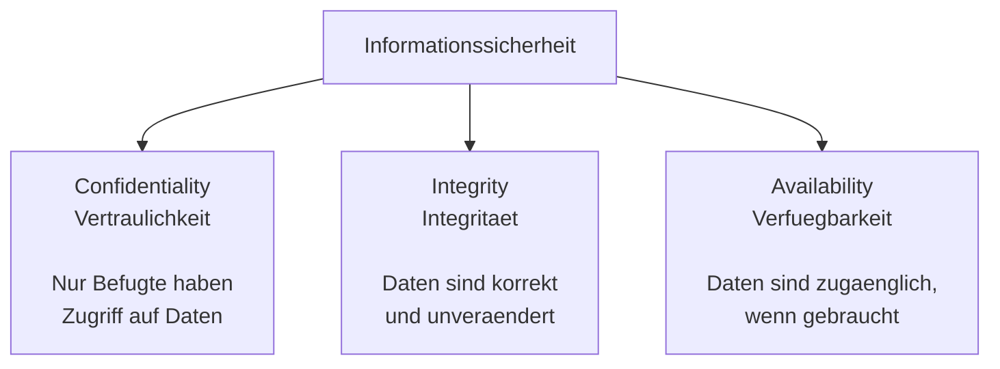
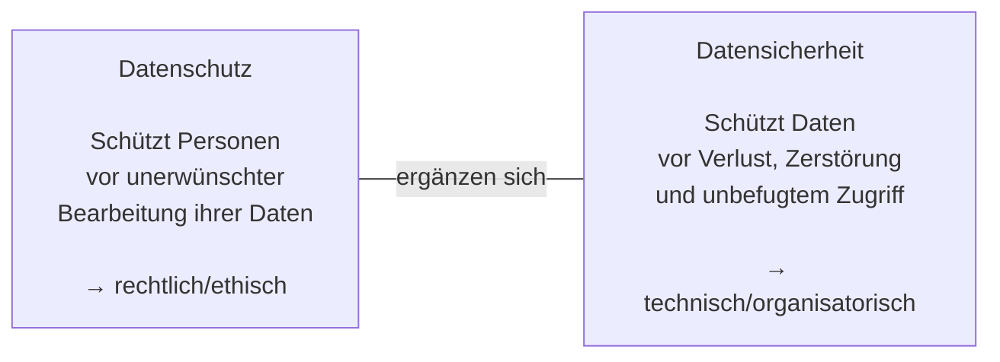
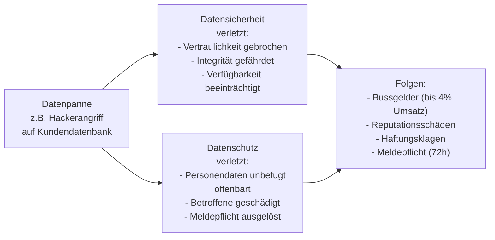
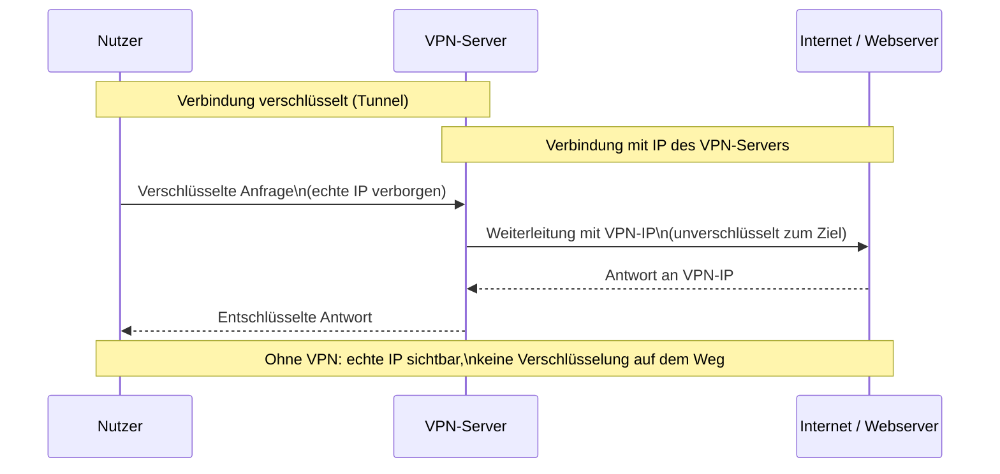
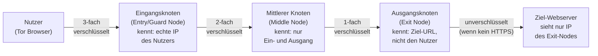

# Tag 03 - CIA-Triade, Datenschutz vs. Datensicherheit & Online-Anonymität

  

	Block: CIA-Triade – Schutzziele der Informationssicherheit (~40')
  

## Die CIA-Triade

> 🤖 **Copilot-Agent:** [M231 T03a CIA-Triade](https://m365.cloud.microsoft/chat/?titleId=T_ee6f652f-82e3-c68f-3ea1-d51c6decaac9&source=embedded-builder) — mit dem TBZ-Konto öffnen und **Start** tippen.

Bevor wir Datenschutz und Datensicherheit einander gegenüberstellen, brauchen wir eine gemeinsame Basis: die drei klassischen Schutzziele der Informationssicherheit.

| Ziel | Bedeutung | Beispiel für eine Verletzung |
|---|---|---|
| **Confidentiality** (Vertraulichkeit) | Nur befugte Personen haben Zugriff auf Daten | Ein Mitarbeiter liest Kundendaten ohne dienstlichen Grund |
| **Integrity** (Integrität) | Daten sind korrekt und unverändert | Eine Rechnung wird unbemerkt manipuliert |
| **Availability** (Verfügbarkeit) | Daten/Systeme sind bei Bedarf zugänglich | Ein Server ist wegen eines Angriffs nicht erreichbar |

> **Merksatz:** Die CIA-Triade beschreibt, *was* Datensicherheit technisch erreichen will. Sie ist die technische Grundlage, auf der Datenschutz – der rechtliche Schutz von Personendaten – aufbaut. Dazu gleich mehr im nächsten Block.

*(Vertiefung – reale Fälle, Risikomanagement und technische Massnahmen zu CIA folgen an Tag 8.)*

---

### Kurzübung: Welches CIA-Ziel ist betroffen?

Ordnen Sie jede Situation dem passenden CIA-Ziel zu (Mehrfachnennung möglich).

| Nr. | Situation | Betroffenes CIA-Ziel |
|---|---|---|
| 1 | Ein Ransomware-Angriff verschlüsselt alle Dateien eines Spitals. | |
| 2 | Ein Praktikant liest heimlich Personalakten von Kolleg:innen. | |
| 3 | Auf einer Webseite werden Preise durch eine Sicherheitslücke unbemerkt verändert. | |
| 4 | Ein DDoS-Angriff legt einen Online-Shop für Stunden lahm. | |

> Sozialform: Einzelarbeit → Plenum
> Dauer: 10min

Bearbeiten Sie die Tabelle zunächst allein. Im Plenum werden die Zuordnungen kurz besprochen und begründet.

  

	Block: Datenschutz vs. Datensicherheit (~45')
  

## Datenschutz und Datensicherheit – wo ist der Unterschied?

> 🤖 **Copilot-Agent:** [M231 T03b Schutz/Sicherheit](https://m365.cloud.microsoft/chat/?titleId=T_1dc16d89-9697-33b8-aac7-7fc4dacd3cb4&source=embedded-builder) — mit dem TBZ-Konto öffnen und **Start** tippen.

| | Datenschutz | Datensicherheit |
|---|---|---|
| **Ziel** | Persönlichkeitsrechte schützen | Verfügbarkeit, Integrität, Vertraulichkeit sicherstellen |
| **Regelung durch** | Gesetze (DSG, DSGVO) | Technische & organisatorische Massnahmen |
| **Beispiel** | Keine Weitergabe von Kundendaten ohne Einwilligung | Datenverschlüsselung, Backup, Zugriffsschutz |
| **Verantwortlich** | Datenschutzbeauftragter, alle Mitarbeitenden | IT-Abteilung, Systemadministratoren |

> **Merksatz:** Datensicherheit ist eine *Voraussetzung* für Datenschutz. Ohne sichere Systeme kann Datenschutz nicht gewährleistet werden.

---

### Wie eine Datenpanne beide Bereiche betrifft

---

### Think-Pair-Share: Klassifizieren Sie die Situation

Ordnen Sie jede Situation einer Kategorie zu: **Datenschutz** / **Datensicherheit** / **Beides** / **Keines**

| Nr. | Situation | Ihre Einschätzung | Begründung |
|---|---|---|---|
| 1 | Ein Mitarbeiter notiert Passwörter auf einem Post-it am Monitor. | | |
| 2 | Eine Firma gibt Mitarbeiterdaten ohne Einwilligung an Headhunter weiter. | | |
| 3 | Ein Server wird nicht regelmässig gesichert (kein Backup). | | |
| 4 | Eine App fragt beim Signup nach Geburtsdatum, braucht es aber nicht. | | |
| 5 | Die Firewall eines Unternehmens ist falsch konfiguriert und lässt Angriffe durch. | | |

**Think:**
> Sozialform: Einzelarbeit
> Dauer: 5min

Bearbeiten Sie die Tabelle zunächst allein und still – ohne sich mit anderen abzusprechen.

**Pair:**
> Sozialform: Partnerarbeit
> Dauer: 8min

Vergleichen Sie Ihre Einschätzungen mit Ihrer Sitznachbarin / Ihrem Sitznachbarn. Wo sind Sie unterschiedlicher Meinung – und warum?

**Share:**
> Sozialform: Plenum
> Dauer: 7min

Auflösung im Plenum: Reihum wird jede Situation kurz besprochen.

---

### Diskussionsaufgabe

> Sozialform: Plenum
> Dauer: 10min

Ein Krankenhaus speichert Patientendaten unverschlüsselt auf einem freigegebenen Netzlaufwerk.
- Welches Prinzip wird verletzt – Datenschutz, Datensicherheit oder beides?
- Welche Konsequenzen können entstehen?

  

	Block: Datenschutz vs. Datensicherheit – Anwendung & Transfer (~30')
  

### Konkrete Szenarien aus der Praxis

> Sozialform: Plenum
> Dauer: 20min

**Szenario 1: Arztpraxis**
Eine Arztpraxis speichert Patientenakten auf einem unverschlüsselten USB-Stick, der verloren geht.
- *Datensicherheit*: Keine Verschlüsselung, kein Zugriffsschutz → technisches Versagen
- *Datenschutz*: Gesundheitsdaten (besonders schützenswert) wurden offenbart → Meldepflicht, potenzielle Bussgelder

**Szenario 2: Online-Shop**
Ein Online-Shop verkauft Kundendaten (Name, E-Mail, Kaufhistorie) an Werbepartner ohne Einwilligung.
- *Datenschutz*: Verletzung der Zweckbindung und des Einwilligungsprinzips → klarer Verstoss gegen DSG/DSGVO
- *Datensicherheit*: Technisch funktioniert alles – die Verletzung ist rein rechtlich/ethischer Natur

**Szenario 3: Schulverwaltung**
Die Schulverwaltung verwendet dieselbe Software seit 15 Jahren, ohne Updates einzuspielen. Eine bekannte Sicherheitslücke ermöglicht Angreifern den Zugriff auf Schülerdaten.
- *Datensicherheit*: Fehlende Updates = vermeidbare Schwachstelle → organisatorisches Versagen
- *Datenschutz*: Schülerdaten (besonders schutzwürdig, da Minderjährige) wurden gefährdet → mehrfacher Verstoss

---

### Transferaufgabe: Auskunftsbegehren (LB3-Vorbereitung)

> Sozialform: Einzelarbeit
> Dauer: 10min
> Abgabe: im Lernjournal festhalten

Das Auskunftsbegehren ist ein Formular, mit dem Sie von einem Unternehmen Auskunft verlangen können, welche Daten es über Sie gespeichert hat.

1. Suchen Sie online nach «Auskunftsbegehren Muster Schweiz» (z. B. edöb.ch).
2. Was muss ein Auskunftsbegehren beinhalten?
3. An welches Unternehmen würden Sie es schicken – und warum?

*(Das vollständige Ausfüllen und Versenden folgt als LB3-Kriterium Nr. 5 am Checkpoint Tag 7.)*

  

	Block: Online-Anonymität & Datenschutztools (~30', Kernteil – Vertiefung als Selbststudium)
  

## Online-Anonymität

> 🤖 **Copilot-Agent:** [M231 T03c Online-Anonymität](https://m365.cloud.microsoft/chat/?titleId=T_e48bfecd-0a79-b9bf-94ba-807e9b392571&source=embedded-builder) — mit dem TBZ-Konto öffnen und **Start** tippen.

### Warum Anonymität?
- Schutz der Privatsphäre
- Vermeidung von Profiling durch Werbenetze
- Schutz vor Stalking, Belästigung
- Pressefreiheit / Whistleblowing

### Daten die beim Surfen hinterlassen werden

| Datenspur | Wer sieht es? |
|---|---|
| IP-Adresse | Webserver, ISP, Behörden |
| Browser-Fingerprint | Webserver, Werbenetze |
| Cookies | Webseite, Drittanbieter |
| DNS-Anfragen | ISP, DNS-Provider |
| Metadaten (Zeit, Ort) | Viele Beteiligte |

---

### Wie ein VPN funktioniert

Ein VPN (Virtual Private Network) verschlüsselt den gesamten Datenverkehr zwischen dem Gerät des Nutzers und dem VPN-Server.

> **Wichtig:** Der VPN-Anbieter selbst kann Ihren Datenverkehr einsehen. Ein VPN schützt vor dem ISP und Webservern – nicht vor dem VPN-Anbieter selbst. Vertrauenswürdige Anbieter mit Keine-Logs-Richtlinie wählen (z. B. ProtonVPN, Mullvad).

---

### Wie das Tor-Netzwerk funktioniert

Tor leitet den Datenverkehr durch drei zufällig gewählte Knoten. Jeder Knoten kennt nur seinen direkten Vor- und Nachfolger – nie den gesamten Pfad.

> **Tor + HTTPS:** Auch beim Tor-Netzwerk sollte die Zielseite HTTPS verwenden, da der Exit-Node den unverschlüsselten Traffic sehen kann.

---

### Tools für mehr Datenschutz

| Tool | Schutz | Einschränkungen |
|---|---|---|
| **VPN** | Versteckt IP, verschlüsselt Traffic zum VPN-Server | VPN-Anbieter kennt Ihre Aktivitäten |
| **Tor Browser** | Anonymisiert durch mehrere Knoten | Langsam, nicht für alle Dienste geeignet |
| **Browser-Erweiterungen** (uBlock, Privacy Badger) | Blockiert Tracker & Werbung | Kann Webseiten beeinträchtigen |
| **Privacy-Browser** (Firefox, Brave) | Weniger Tracking als Chrome | Kein vollständiger Schutz |
| **Suchmaschinen** (DuckDuckGo, Startpage) | Kein Nutzerprofil | Weniger personalisierte Ergebnisse |
| **Wegwerf-E-Mail** | Keine Registrierung mit Haupt-Mail | Temporär, kein Antworten |

---

### Erweiterte Schutzmassnahmen (Referenz)

Im Unterricht nur kurz gestreift – dient als Nachschlagewerk fürs Lernjournal und die Transferaufgabe.

| Massnahme | Kurzbeschreibung |
|---|---|
| **DNS-over-HTTPS (DoH)** | Verschlüsselt DNS-Anfragen (sonst sieht der ISP, welche Domains besucht werden). Firefox: *Einstellungen → Allgemein → DNS über HTTPS*. Anbieter: Cloudflare (1.1.1.1), NextDNS, Quad9 |
| **E-Mail-Verschlüsselung** | ProtonMail (Ende-zu-Ende, Schweizer Recht) oder PGP/GPG (eigene Schlüssel, clientübergreifend) |
| **Browser-Härtung (Firefox)** | `about:config` → `privacy.resistFingerprinting = true`; Erweiterungen uBlock Origin, LocalCDN, Canvas Blocker |

---

### Grenzen der Anonymität
- Vollständige Anonymität ist im Internet kaum erreichbar
- Kombination von Daten («Browser-Fingerprinting») kann eindeutig sein
- Eigenes Verhalten (Posting, Login) hebt Anonymität auf

---

### Transferaufgabe: Datenschutz-Check

> Sozialform: Einzelarbeit
> Dauer: 5min (Start im Unterricht, bei Bedarf zuhause fertigstellen)
> Abgabe: Lernjournal-Eintrag

Prüfen Sie Ihren eigenen Browser:
1. Testen Sie Ihren Browser-Fingerprint auf: https://coveryourtracks.eff.org
2. Wie viele Tracker blockiert Ihr Browser?
3. Welche Massnahme würden Sie als nächstes umsetzen – und warum?

  

	Block: KI-Werkstatt 2 – Faktencheck einer KI-Aussage (~15')
  

## KI als Recherche-Einstieg – mit Faktencheck-Pflicht

KI-Sprachmodelle können Rechtsthemen wie das Datenschutzrecht plausibel klingend, aber **inhaltlich falsch** darstellen (Halluzination). Gerade bei Gesetzestexten ist eine unabhängige Quellenprüfung Pflicht.

> **Erinnerung an den Nutzungsrahmen:** KI darf hier als Recherche-Einstieg dienen – die Validierung gegen eine offizielle Quelle ersetzt sie nicht.

---

### Transferaufgabe: DSGVO/revDSG-Aussage validieren (kompakt)

> Sozialform: Partnerarbeit
> Dauer: 10min
> Abgabe: Plenum (Kurzrunde, ~5min)

In einem Zug: Bitten Sie eine KI um eine konkrete Aussage zu einem der heutigen Themen, z. B.: „Nenne die gesetzliche Frist, innerhalb derer ein Unternehmen ein Auskunftsbegehren beantworten muss, und die Frist für die Meldung einer Datenpanne an den EDÖB." Prüfen Sie die Aussage direkt im Anschluss gegen die **offizielle Quelle** (edoeb.admin.ch bzw. Gesetzestext des revDSG): Stimmen Fristen, Paragraphen, Zuständigkeiten?

Im Plenum: Kurze Diskussion – warum ist ein Faktencheck bei KI-Antworten zu Rechtsfragen besonders wichtig, welche Konsequenzen hätte eine falsche Frist im Berufsalltag?

*(Optional, nicht bewertet: Halten Sie Ihr Ergebnis informell im Lernjournal fest.)*

