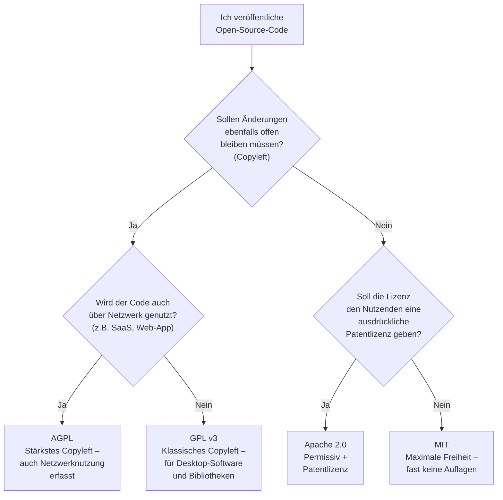
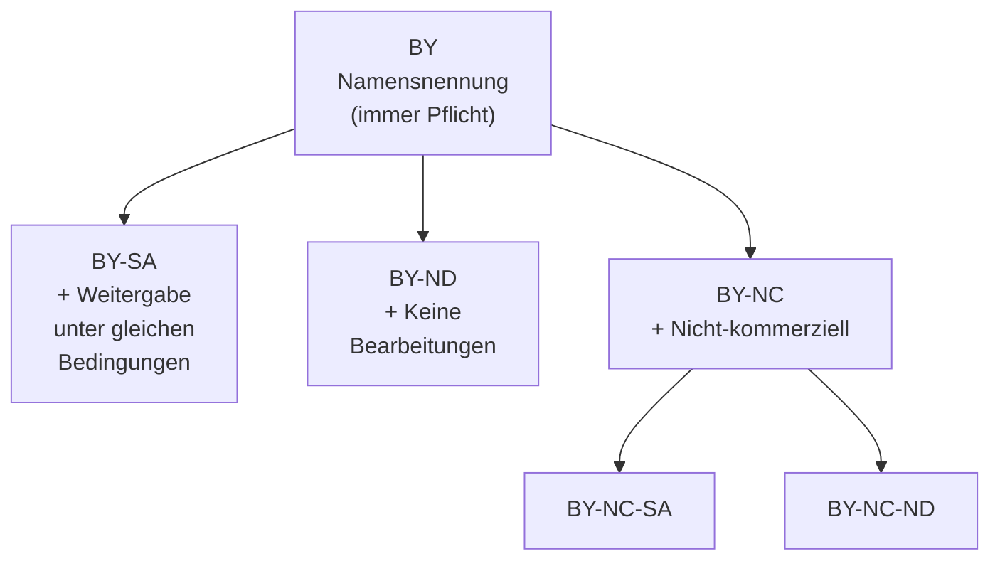
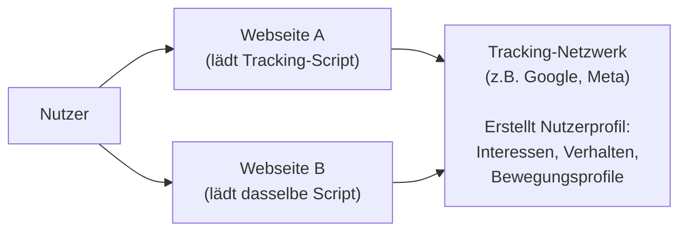
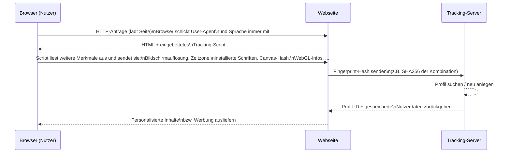
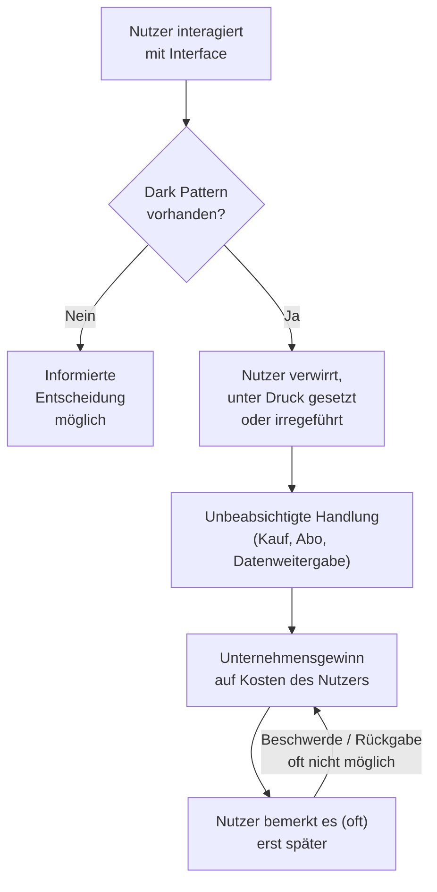

# Tag 04 - Lizenzmodelle & Privacy-Threats

  

	Block: Lizenzmodelle & Urheberrecht / Creative Commons (~45')
  

## Urheberrecht

> 🤖 **Copilot-Agent:** [M231 T04a Lizenzmodelle](https://m365.cloud.microsoft/chat/?titleId=T_05420929-01a5-7ecc-eb94-135a74874470&source=embedded-builder) — mit dem TBZ-Konto öffnen und **Start** tippen.

Das **Urheberrecht** schützt geistige Schöpfungen (Texte, Bilder, Code, Musik usw.) automatisch ab dem Moment der Erstellung – ohne Registrierung.

**Grundsatz:** Wer etwas erschafft, hat das Recht daran. Nutzung durch andere braucht eine **Erlaubnis (Lizenz)**.

---

## Lizenzmodelle im Überblick

### Proprietäre Software

| Merkmal | Erklärung |
|---|---|
| Quellcode | Nicht zugänglich |
| Verwendung | Nur gemäss Lizenzvertrag (EULA) |
| Weitergabe | Verboten oder stark eingeschränkt |
| Beispiele | Microsoft Office, Adobe Photoshop, macOS |

### Open Source Software (OSS)

| Merkmal | Erklärung |
|---|---|
| Quellcode | Öffentlich zugänglich |
| Verwendung | Kostenlos, oft auch kommerziell |
| Weitergabe | Erlaubt, je nach Lizenz |
| Beispiele | Linux, Firefox, LibreOffice |

**Wichtige OSS-Lizenzen:**

| Lizenz | Copyleft | Kommerziell | Bemerkung |
|---|:---:|:---:|---|
| MIT | — | ✓ | Sehr permissiv, fast keine Einschränkungen |
| Apache 2.0 | — | ✓ | Ausdrückliche Patentlizenz: Die Autoren erlauben die Nutzung ihrer Patente, soweit sie ihre Beiträge betreffen. Wer selbst wegen des Werks eine Patentklage einreicht, verliert diese Patentlizenz. |
| GPL v3 | ✓ | ✓ | Abgeleitete Werke müssen bei der Weitergabe ebenfalls unter der GPL stehen. Enthält auch eine ausdrückliche Patentlizenz. |
| LGPL | Teilweise | ✓ | Für Bibliotheken (Linking erlaubt) |
| AGPL | ✓ | ✓ | GPL auch für Netzwerknutzung |

> **Copyleft:** Die Pflicht entsteht bei der **Weitergabe** des veränderten Programms: Wer es weitergibt, muss den Quellcode des abgeleiteten Werks unter der GPL mitliefern. Private Nutzung ohne Weitergabe löst keine Pflicht aus. Verkaufen ist erlaubt. Bei der AGPL gilt das auch, wenn andere das veränderte Programm nur über ein Netzwerk nutzen (z. B. SaaS, Web-App).

---

### OSS-Lizenz-Entscheidungsbaum

Welche Lizenz passt zu Ihrem Projekt? Dieses Diagramm hilft bei der Wahl:

---

### Creative Commons (CC)

Creative Commons Lizenzen werden für **Inhalte** (Texte, Bilder, Videos, Musik) verwendet.

| Kürzel | Bedeutung |
|---|---|
| **BY** | Namensnennung (Attribution) |
| **SA** | Share Alike – Weitergabe unter gleichen Bedingungen |
| **NC** | Non-Commercial – keine kommerzielle Nutzung |
| **ND** | No Derivatives – keine Bearbeitungen |
| **CC0** | Public Domain – Verzicht auf alle Rechte, soweit rechtlich möglich |

**CC-Lizenzen im Vergleich – Anwendungsfälle:**

| Lizenz | Bearbeitung erlaubt | Kommerziell erlaubt | Typischer Anwendungsfall |
|---|:---:|:---:|---|
| CC0 | ✓ | ✓ | Wissenschaftliche Daten, Public Domain |
| CC BY | ✓ | ✓ | Akademische Texte |
| CC BY-SA | ✓ | ✓ | Wikipedia-Texte, freie Lehrmaterialien |
| CC BY-NC | ✓ | — | Bildungsmaterial für den Unterricht |
| CC BY-ND | — | ✓ | Pressemitteilungen, offizielle Dokumente |
| CC BY-NC-SA | ✓ | — | Schüler-/Studentenprojekte |
| CC BY-NC-ND | — | — | Restriktivste CC-Lizenz, nur Weitergabe unverändert |

---

### Transferaufgabe: Lizenz bestimmen

> Sozialform: Partnerarbeit → Plenum
> Dauer: 15min
> Abgabe: Plenum

**Teil A – Welche Lizenz passt?** Begründen Sie jede Wahl mit der Bedingung, die den Ausschlag gibt.

| Nr. | Szenario | Lizenz | Begründung |
|---|---|---|---|
| 1 | Eine Gemeinde veröffentlicht ihre Messdaten zur Luftqualität. Alle sollen sie ohne jede Bedingung verwenden dürfen, auch ohne die Gemeinde zu nennen. | | |
| 2 | Ein Fotograf erlaubt, seine Bilder zu verbreiten, auch in Firmenbroschüren. Er will dabei immer genannt werden, und die Bilder dürfen nicht verändert werden. | | |
| 3 | Ein Team veröffentlicht eine Programmbibliothek. Änderungen an der Bibliothek selbst sollen offen bleiben müssen. Programme, die die Bibliothek nur einbinden, dürfen proprietär bleiben. | | |

**Teil B – Ist das erlaubt?** Antworten Sie mit Ja oder Nein und nennen Sie die Lizenzbedingung, auf die es ankommt.

| | Situation | Erlaubt? | Begründung |
|---|---|---|---|
| a | Sie verkaufen ein unverändertes Programm unter GPL v3 auf einem USB-Stick und legen den Quellcode bei. | | |
| b | Ihr Team verändert ein Programm unter GPL v3 und setzt es nur intern im Lehrbetrieb ein, ohne es weiterzugeben. Den veränderten Quellcode veröffentlichen Sie nicht. | | |
| c | Sie verwenden ein Bild unter CC BY-NC auf der Website Ihres Lehrbetriebs, um ein Produkt zu bewerben. | | |
| d | Sie übersetzen einen Artikel unter CC BY-SA ins Deutsche und veröffentlichen die Übersetzung mit Namensnennung unter CC BY-NC. | | |

Bearbeiten Sie beide Teile zu zweit. Im Plenum werden die Lösungen besprochen.

  

	Block: Privacy-Threats – Cookies, Tracking & Fingerprinting (~30')
  

## Privacy-Threats

> 🤖 **Copilot-Agent:** [M231 T04b Privacy-Threats](https://m365.cloud.microsoft/chat/?titleId=T_f2f173db-90aa-0770-c970-22d68e2c9183&source=embedded-builder) — mit dem TBZ-Konto öffnen und **Start** tippen.

### Cookies

Cookies sind kleine Textdateien, die Webseiten im Browser speichern.

| Cookie-Typ | Zweck | Datenschutz-Relevanz |
|---|---|---|
| **Session-Cookies** | Login-Status halten | Niedrig (temporär) |
| **Persistente Cookies** | Präferenzen merken, Wiedererkennung | Mittel |
| **Third-Party-Cookies** | Tracking über verschiedene Webseiten | **Hoch** |

> **Verwandte Technik – Tracking-Pixel:** kein Cookie, sondern ein unsichtbares 1×1-Pixel-Bild, z. B. in E-Mails. Wird es geladen, erfährt der Absender, dass die E-Mail geöffnet wurde. Datenschutz-Relevanz hoch.

---

### Wie Tracking funktioniert

**Verfahren:**
- **Cookies:** Browser speichert ID, wird bei jedem Besuch mitgeschickt
- **Fingerprinting:** Browser-Eigenschaften (Auflösung, Schriften, Plugins) ergeben einzigartiges Profil
- **Login-Tracking:** Werbenetze erkennen eingeloggte Nutzer über Plattformgrenzen hinweg

---

### Browser-Fingerprinting im Detail

Browser-Fingerprinting ist eine Tracking-Methode, die ohne Cookies auskommt und dadurch schwerer zu blockieren ist. Der Browser verrät beim Laden einer Seite viele Eigenschaften, deren Kombination einzigartig ist.

**Typische Fingerprint-Merkmale:**

| Merkmal | Beispielwert | Einzigartigkeit |
|---|---|---|
| Bildschirmauflösung | 1920×1080 | Gering |
| Zeitzone + Sprache | Europe/Zurich + de-CH | Mittel |
| User-Agent (Browser + OS) | Firefox 124 / Windows 11 | Mittel |
| Installierte Schriften | Arial, Helvetica, ... | Hoch |
| Canvas-Rendering | Einzigartiger Pixel-Hash | Sehr hoch |
| WebGL-Renderer | NVIDIA GeForce RTX ... | Hoch |
| Kombination aller Merkmale | — | Oft eindeutig |

> **Kombination macht's:** Kein einzelnes Merkmal ist eindeutig, die Kombination von 10–15 Merkmalen identifiziert den Browser in der Regel eindeutig.

---

### Rechtliche Situation

**DSGVO / Cookie-Consent:**
- Cookies, die nicht technisch notwendig sind (insbesondere Third-Party- und Tracking-Cookies), brauchen eine **vorgängige, aktive Einwilligung**
- Cookie-Consent-Banner müssen eine echte Wahlmöglichkeit bieten
- «Ablehnen» muss genauso einfach sein wie «Akzeptieren»

---

### Schutzmassnahmen

1. Browser-Erweiterungen (uBlock Origin, Privacy Badger)
2. Privacy-fokussierte Browser (Firefox, Brave)
3. Regelmässig Cookies löschen
4. Third-Party-Cookies blockieren (Einstellung im Browser)
5. DNS-over-HTTPS (DoH) aktivieren
6. `privacy.resistFingerprinting` in Firefox aktivieren

---

### Transferaufgabe: Welche Tracking-Methode ist das?

> Sozialform: Einzelarbeit → Plenum
> Dauer: 10min
> Abgabe: Plenum

*(Den eigenen Fingerprint haben Sie an Tag 3 im Datenschutz-Check geprüft.)*

**Teil A:** Welche Methode bzw. welcher Cookie-Typ ist hier im Spiel? Nennen Sie den Hinweis im Text, an dem Sie es erkennen.

| Nr. | Situation | Methode / Cookie-Typ | Hinweis im Text |
|---|---|---|---|
| 1 | Sie stellen eine Nachrichtenseite auf Französisch um. Eine Woche später öffnen Sie die Seite wieder, und sie erscheint immer noch auf Französisch. | | |
| 2 | Sie sind im Browser bei Ihrem Social-Media-Konto angemeldet. Auf einer Rezeptseite ohne eigenes Login zeigt ein eingebetteter «Gefällt mir»-Button an, dass drei Ihrer Kontakte die Seite mögen. | | |
| 3 | Sie melden sich in einem Webshop an und legen etwas in den Warenkorb. Nachdem Sie den Browser geschlossen und wieder geöffnet haben, sind Sie abgemeldet und der Warenkorb ist leer. | | |
| 4 | Eine Testseite zeigt Ihnen Ihre Bildschirmauflösung, Zeitzone, installierten Schriften und einen Canvas-Hash an und meldet: «Ihr Browser ist unter allen getesteten Browsern einzigartig.» | | |
| 5 | Auf einer Gesundheitsseite sind Scripts von fünf fremden Domains eingebunden. Dieselben Domains finden Sie auch auf einer Shoppingseite und einem Stellenportal. Was können die Firmen hinter diesen Domains ableiten, und warum ist das bei einer Gesundheitsseite besonders heikel? | | |

**Teil B:**

1. Sie blockieren in Ihrem Browser die Third-Party-Cookies. Bei welchen der Situationen 1–5 ändert sich dadurch etwas, bei welchen nicht? Begründen Sie.
2. Welche Schutzmassnahme aus der Liste hilft in Situation 4? Begründen Sie.

  

	Block: Dark Patterns & UX-Manipulation (~25')
  

## Dark Patterns

> 🤖 **Copilot-Agent:** [M231 T04c Dark Patterns](https://m365.cloud.microsoft/chat/?titleId=T_79e000ce-d723-b4c8-8ebe-165ba792c0cc&source=embedded-builder) — mit dem TBZ-Konto öffnen und **Start** tippen.

Dark Patterns sind **Gestaltungstricks in Benutzeroberflächen**, die Nutzer zu einer Handlung verleiten, die sie nicht wollten oder beabsichtigt hätten.

### Wie Dark Patterns Entscheidungen manipulieren

---

### Häufige Dark Patterns

| Pattern | Beschreibung | Beispiel |
|---|---|---|
| **Roach Motel** | Einfach rein, schwer raus | Newsletter abonnieren (1 Klick), abmelden (7 Schritte) |
| **Confirmshaming** | Ablehnen-Button formuliert Ablehnung beschämend | „Nein danke, ich will keine Vorteile." |
| **Hidden Costs** | Zusatzkosten erscheinen erst am Ende des Kaufprozesses | Buchungsgebühren beim Checkout |
| **Sneak into Basket** | Produkte werden still in den Warenkorb gelegt | Versicherung vorausgewählt |
| **Privacy Zuckering** | Datenschutzeinstellungen versteckt/kompliziert | Cookie-Einstellungen 12 Klicks tief |
| **Disguised Ads** | Werbung sieht aus wie ein Suchergebnis | „Sponsored" kaum erkennbar |
| **Forced Continuity** | Kostenlos-Abo läuft automatisch in kostenpflichtig über | Keine Erinnerung vor Ende der Testphase |

---

### Weitere Dark Patterns – vertiefte Beispiele

**Misdirection (Ablenkung):**
Ein Popup erscheint beim Checkout-Prozess mit einem Sonderangebot. Der «Ablehnen»-Button ist winzig, blass und ausserhalb der optischen Mitte platziert – der «Akzeptieren»-Button ist gross, grün und sofort sichtbar.
*Wirkung:* Der Nutzer klickt unbewusst auf das attraktivere Element, ohne die Konsequenz zu überdenken.

**Urgency / Scarcity (Künstliche Dringlichkeit):**
«Nur noch 2 Stück verfügbar!» oder «Angebot endet in 00:04:32» – obwohl der Countdown nach Ablauf einfach zurückgesetzt wird.
*Wirkung:* Künstlicher Zeitdruck verhindert rationale Abwägung. Studien zeigen, dass Dringlichkeit die Kaufwahrscheinlichkeit stark erhöht.

**Trick Questions (Verwirrende Checkboxen):**
«Ich möchte *keine* E-Mails von Partnerfirmen erhalten» – eine doppelte Verneinung, die viele falsch verstehen.
*Wirkung:* Nutzer meinen, Werbung abzulehnen, stimmen ihr tatsächlich zu.

**Friend Spam:**
Eine App fragt nach Zugriff auf das Adressbuch «um Freunde einzuladen». Dann werden automatisch Einladungsmails an alle Kontakte verschickt – ohne weiteres Zutun des Nutzers.
*Wirkung:* Virale Verbreitung auf Kosten des Nutzers und seiner Kontakte.

---

### Rechtliche Lage

- DSGVO: Dark Patterns bei Cookie-Consent sind **unzulässig**
- EU Digital Services Act (DSA): Verbietet bestimmte Dark Patterns ausdrücklich (Art. 25 DSA, gilt für Anbieter von Online-Plattformen, nicht nur für sehr grosse)
- Konsumentenschutz: Irreführende Praktiken können UWG (Bundesgesetz gegen unlauteren Wettbewerb) verletzen
- EU-Kommission: Aktive Durchsetzung, z. B. Bussgelder gegen grosse Plattformen

---

### Dark Patterns melden

Wenn Sie ein Dark Pattern entdecken, können Sie es melden:

| Meldestelle | Zuständigkeit | Link |
|---|---|---|
| **SECO** (Schweiz) | Unlautere Handelspraktiken (UWG) | seco.admin.ch |
| **EDÖB** (Schweiz) | Datenschutzverletzungen | edoeb.admin.ch |
| **EU-Kommission** | DSA-Verstösse | ec.europa.eu/dsa |
| **darkpatterns.org** | Öffentliche Dokumentation | darkpatterns.org |
| **your.choice** | Cookie-Banner-Verstösse melden | noyb.eu |

> **noyb** (None Of Your Business) ist eine europäische Datenschutz-NGO, die systematisch Dark Patterns bei Cookie-Bannern meldet und Beschwerde bei Behörden einreicht.

  

	Block: KI-Werkstatt 3 – KI-gestützte Dark-Pattern-Analyse (~20')
  

## KI als Analyse-Werkzeug – mit kritischer Prüfung

KI kann helfen, Webseiten systematisch auf Dark Patterns zu durchsuchen – ersetzt aber nicht das eigene kritische Urteil. Auch hier gilt der Nutzungsrahmen aus Tag 1: KI liefert Hinweise, die eigentliche Einschätzung und Begründung bleibt Ihre Aufgabe.

---

### Transferaufgabe: Dark Pattern entlarven – mit KI-Unterstützung

> Sozialform: Partnerarbeit → Plenum
> Dauer: 20min
> Abgabe: Plenum, Ergebnis im Lernjournal festhalten

1. Besuchen Sie zwei Webseiten Ihrer Wahl (z. B. ein Online-Shop mit Newsletter-Anmeldung, ein Cookie-Banner, eine Abo-Kündigung).
2. **Zuerst ohne KI:** Halten Sie fest, welches Dark Pattern Sie vermuten, und begründen Sie es mit der Tabelle von vorhin. Findet sich kein Dark Pattern, halten Sie fest, woran Sie das erkennen.
3. Beschreiben Sie danach einer KI, was Sie auf der Seite sehen (z. B. Wortlaut der Buttons, Anordnung, Anzahl Klicks), und fragen Sie, ob dies ein Dark Pattern sein könnte und welches.
4. **Vergleichen Sie und prüfen Sie die KI-Antwort kritisch:** Stimmt sie mit Ihrer Einschätzung überein? Passt die genannte Kategorie wirklich zur Tabelle? Übertreibt oder untertreibt die KI? Erfindet sie ein Pattern, das gar nicht zutrifft?
5. Beschreiben Sie für eine der beiden Seiten, wie die Stelle gestaltet sein müsste, damit sie kein Dark Pattern mehr ist.
6. Notieren Sie: Webseite, Ihr vermutetes Dark Pattern, die Einschätzung der KI, wer nach Ihrer Prüfung recht hatte, und Ihre finale Begründung.

Halten Sie das Ergebnis danach im Lernjournal fest.

