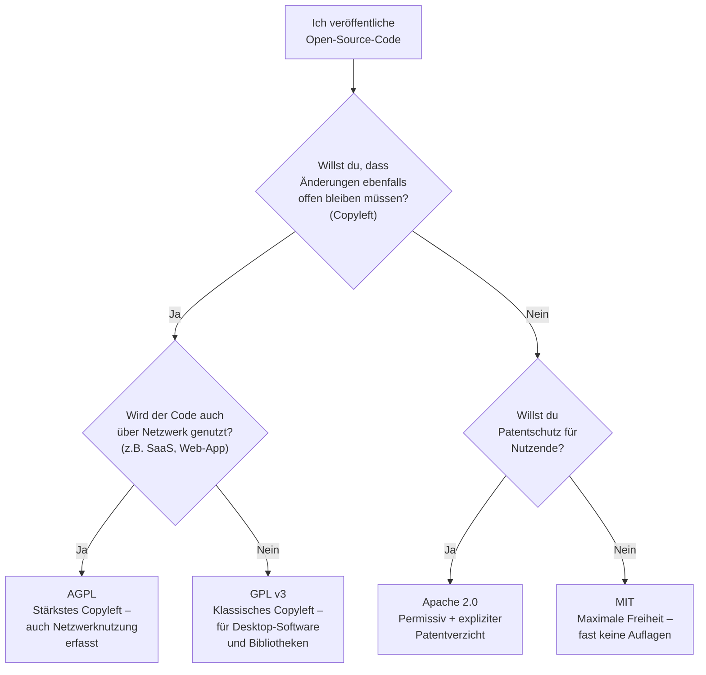
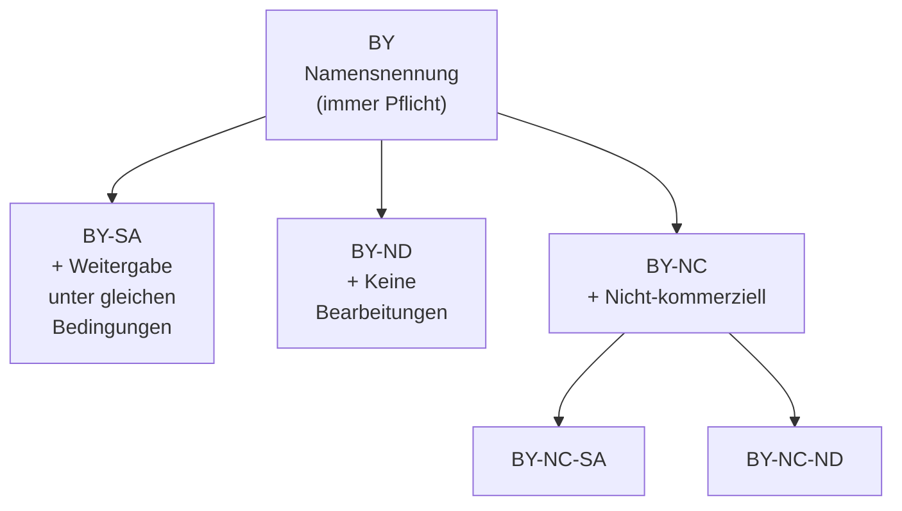
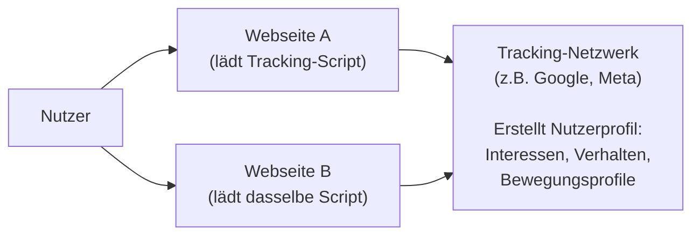
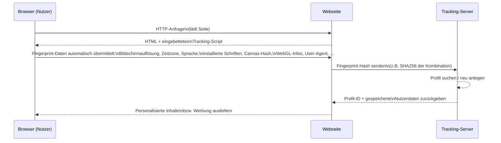
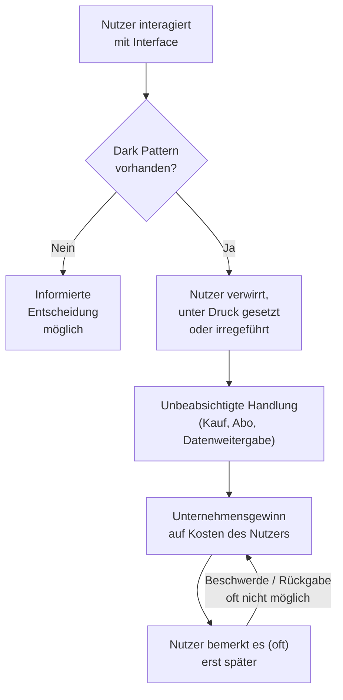

# Tag 04 - Lizenzmodelle & Privacy-Threats

  

	Block: Lizenzmodelle & Urheberrecht / Creative Commons (~50')
  

## Urheberrecht

> 🤖 **Copilot-Agent:** [M231 T04a Lizenzmodelle](https://m365.cloud.microsoft/chat/?titleId=T_05420929-01a5-7ecc-eb94-135a74874470&source=embedded-builder) — mit dem TBZ-Konto öffnen und **Start** tippen.

Das **Urheberrecht** schützt geistige Schöpfungen (Texte, Bilder, Code, Musik usw.) automatisch ab dem Moment der Erstellung – ohne Registrierung.

**Grundsatz:** Wer etwas erschafft, hat das Recht daran. Nutzung durch andere braucht eine **Erlaubnis (Lizenz)**.

---

## Lizenzmodelle im Überblick

### Proprietäre Software

| Merkmal | Erklärung |
|---|---|
| Quellcode | Nicht zugänglich |
| Verwendung | Nur gemäss Lizenzvertrag (EULA) |
| Weitergabe | Verboten oder stark eingeschränkt |
| Beispiele | Microsoft Office, Adobe Photoshop, macOS |

### Open Source Software (OSS)

| Merkmal | Erklärung |
|---|---|
| Quellcode | Öffentlich zugänglich |
| Verwendung | Kostenlos, oft auch kommerziell |
| Weitergabe | Erlaubt, je nach Lizenz |
| Beispiele | Linux, Firefox, LibreOffice, VS Code |

**Wichtige OSS-Lizenzen:**

| Lizenz | Copyleft | Kommerziell | Bemerkung |
|---|:---:|:---:|---|
| MIT | — | ✓ | Sehr permissiv, fast keine Einschränkungen |
| Apache 2.0 | — | ✓ | Patentschutz inklusive |
| GPL v3 | ✓ | ✓ | Abgeleitete Werke müssen auch GPL sein |
| LGPL | Teilweise | ✓ | Für Bibliotheken (Linking erlaubt) |
| AGPL | ✓ | ✓ | GPL auch für Netzwerknutzung |

> **Copyleft:** Wer GPL-Code verwendet und verändert, muss die Änderungen ebenfalls unter GPL veröffentlichen.

---

### OSS-Lizenz-Entscheidungsbaum

Welche Lizenz passt zu Ihrem Projekt? Dieses Diagramm hilft bei der Wahl:

---

### Creative Commons (CC)

Creative Commons Lizenzen werden für **Inhalte** (Texte, Bilder, Videos, Musik) verwendet.

| Kürzel | Bedeutung |
|---|---|
| **BY** | Namensnennung (Attribution) |
| **SA** | Share Alike – Weitergabe unter gleichen Bedingungen |
| **NC** | Non-Commercial – keine kommerzielle Nutzung |
| **ND** | No Derivatives – keine Bearbeitungen |
| **CC0** | Public Domain – alle Rechte aufgegeben |

**CC-Lizenzen im Vergleich – Anwendungsfälle:**

| Lizenz | Bearbeitung erlaubt | Kommerziell erlaubt | Typischer Anwendungsfall |
|---|:---:|:---:|---|
| CC0 | ✓ | ✓ | Wissenschaftliche Daten, Public Domain |
| CC BY | ✓ | ✓ | Wikipedia, akademische Texte |
| CC BY-SA | ✓ | ✓ | Wikipedia (Bilder), freie Lehrmaterialien |
| CC BY-NC | ✓ | — | Bildungsmaterial für den Unterricht |
| CC BY-ND | — | ✓ | Pressemitteilungen, offizielle Dokumente |
| CC BY-NC-SA | ✓ | — | Schüler-/Studentenprojekte |
| CC BY-NC-ND | — | — | Restriktivste CC-Lizenz, nur Weitergabe unverändert |

---

### Transferaufgabe: Lizenz bestimmen

> Sozialform: Partnerarbeit
> Dauer: 10min
> Abgabe: Plenum

Bestimmen Sie für jedes Szenario die passende Lizenz:

1. Ein Schulprojekt soll frei nutzbar und veränderbar sein, aber immer mit Namensnennung.
2. Ein Unternehmen möchte Code veröffentlichen, Änderungen aber nicht zwingend zurückgeben.
3. Ein Fotograf erlaubt kostenlose Nutzung seiner Bilder, aber keine Bearbeitungen und keine kommerzielle Verwendung.
4. Eine Bibliothek soll in proprietäre Software eingebunden werden dürfen.

  

	Block: Privacy-Threats – Cookies, Tracking & Fingerprinting (~45')
  

## Privacy-Threats

> 🤖 **Copilot-Agent:** [M231 T04b Privacy-Threats](https://m365.cloud.microsoft/chat/?titleId=T_f2f173db-90aa-0770-c970-22d68e2c9183&source=embedded-builder) — mit dem TBZ-Konto öffnen und **Start** tippen.

### Cookies

Cookies sind kleine Textdateien, die Webseiten im Browser speichern.

| Cookie-Typ | Zweck | Datenschutz-Relevanz |
|---|---|---|
| **Session-Cookies** | Login-Status halten | Niedrig (temporär) |
| **Persistente Cookies** | Präferenzen merken, Wiedererkennung | Mittel |
| **Third-Party-Cookies** | Tracking über verschiedene Webseiten | **Hoch** |
| **Tracking-Pixel** | Unsichtbares 1×1 Pixel verfolgt E-Mail-Öffnungen | Hoch |

---

### Wie Tracking funktioniert

**Verfahren:**
- **Cookies:** Browser speichert ID, wird bei jedem Besuch mitgeschickt
- **Fingerprinting:** Browser-Eigenschaften (Auflösung, Schriften, Plugins) ergeben einzigartiges Profil
- **Login-Tracking:** Werbenetze erkennen eingeloggte Nutzer über Plattformgrenzen hinweg

---

### Browser-Fingerprinting im Detail

Browser-Fingerprinting ist eine Tracking-Methode, die ohne Cookies auskommt und dadurch schwerer zu blockieren ist. Der Browser verrät beim Laden einer Seite viele Eigenschaften, deren Kombination einzigartig ist.

**Typische Fingerprint-Merkmale:**

| Merkmal | Beispielwert | Einzigartigkeit |
|---|---|---|
| Bildschirmauflösung | 1920×1080 | Gering |
| Zeitzone + Sprache | Europe/Zurich + de-CH | Mittel |
| User-Agent (Browser + OS) | Firefox 124 / Windows 11 | Mittel |
| Installierte Schriften | Arial, Helvetica, ... | Hoch |
| Canvas-Rendering | Einzigartiger Pixel-Hash | Sehr hoch |
| WebGL-Renderer | NVIDIA GeForce RTX ... | Hoch |
| Kombination aller Merkmale | — | Oft eindeutig |

> **Kombination macht's:** Kein einzelnes Merkmal ist eindeutig, die Kombination von 10–15 Merkmalen identifiziert den Browser in der Regel eindeutig.

---

### Rechtliche Situation

**DSGVO / Cookie-Consent:**
- Third-Party-Cookies brauchen **ausdrückliche Einwilligung**
- Cookie-Consent-Banner müssen eine echte Wahlmöglichkeit bieten
- «Ablehnen» muss genauso einfach sein wie «Akzeptieren»

---

### Schutzmassnahmen

1. Browser-Erweiterungen (uBlock Origin, Privacy Badger)
2. Privacy-fokussierte Browser (Firefox, Brave)
3. Regelmässig Cookies löschen
4. Third-Party-Cookies blockieren (Einstellung im Browser)
5. DNS-over-HTTPS (DoH) aktivieren
6. `privacy.resistFingerprinting` in Firefox aktivieren

---

### Transferaufgabe: Eigenen Fingerprint prüfen

> Sozialform: Einzelarbeit
> Dauer: 10min
> Abgabe: Lernjournal-Eintrag (mindestens 3 Erkenntnisse)

1. Öffnen Sie https://coveryourtracks.eff.org in Ihrem normalen Browser.
2. Klicken Sie auf «Test Your Browser».
3. Notieren Sie in Ihrem Lernjournal:
   - Ist Ihr Browser eindeutig identifizierbar (Unique / Not Unique)?
   - Welche drei Merkmale tragen am meisten zur Eindeutigkeit bei?
   - Was würden Sie ändern, um Ihren Fingerprint weniger eindeutig zu machen?

  

	Block: Dark Patterns & UX-Manipulation (~40')
  

## Dark Patterns

> 🤖 **Copilot-Agent:** [M231 T04c Dark Patterns](https://m365.cloud.microsoft/chat/?titleId=T_79e000ce-d723-b4c8-8ebe-165ba792c0cc&source=embedded-builder) — mit dem TBZ-Konto öffnen und **Start** tippen.

Dark Patterns sind **Gestaltungstricks in Benutzeroberflächen**, die Nutzer zu einer Handlung verleiten, die sie nicht wollten oder beabsichtigt hätten.

### Wie Dark Patterns Entscheidungen manipulieren

---

### Häufige Dark Patterns

| Pattern | Beschreibung | Beispiel |
|---|---|---|
| **Roach Motel** | Einfach rein, schwer raus | Newsletter abonnieren (1 Klick), abmelden (7 Schritte) |
| **Confirmshaming** | Ablehnen-Button formuliert Ablehnung beschämend | „Nein danke, ich will keine Vorteile." |
| **Hidden Costs** | Zusatzkosten erscheinen erst am Ende des Kaufprozesses | Buchungsgebühren beim Checkout |
| **Sneak into Basket** | Produkte werden still in den Warenkorb gelegt | Versicherung vorausgewählt |
| **Privacy Zuckering** | Datenschutzeinstellungen versteckt/kompliziert | Cookie-Einstellungen 12 Klicks tief |
| **Disguised Ads** | Werbung sieht aus wie ein Suchergebnis | „Sponsored" kaum erkennbar |
| **Forced Continuity** | Kostenlos-Abo läuft automatisch in kostenpflichtig über | Keine Erinnerung vor Ende der Testphase |

---

### Weitere Dark Patterns – vertiefte Beispiele

**Misdirection (Ablenkung):**
Ein Popup erscheint beim Checkout-Prozess mit einem Sonderangebot. Der «Ablehnen»-Button ist winzig, blass und ausserhalb der optischen Mitte platziert – der «Akzeptieren»-Button ist gross, grün und sofort sichtbar.
*Wirkung:* Der Nutzer klickt unbewusst auf das attraktivere Element, ohne die Konsequenz zu überdenken.

**Urgency / Scarcity (Künstliche Dringlichkeit):**
«Nur noch 2 Stück verfügbar!» oder «Angebot endet in 00:04:32» – obwohl der Countdown nach Ablauf einfach zurückgesetzt wird.
*Wirkung:* Künstlicher Zeitdruck verhindert rationale Abwägung. Studien zeigen, dass Dringlichkeit die Kaufwahrscheinlichkeit stark erhöht.

**Trick Questions (Verwirrende Checkboxen):**
«Ich möchte *keine* E-Mails von Partnerfirmen erhalten» – eine doppelte Verneinung, die viele falsch verstehen.
*Wirkung:* Nutzer meinen, Werbung abzulehnen, stimmen ihr tatsächlich zu.

**Friend Spam:**
Eine App fragt nach Zugriff auf das Adressbuch «um Freunde einzuladen». Dann werden automatisch Einladungsmails an alle Kontakte verschickt – ohne weiteres Zutun des Nutzers.
*Wirkung:* Virale Verbreitung auf Kosten des Nutzers und seiner Kontakte.

---

### Rechtliche Lage

- DSGVO: Dark Patterns bei Cookie-Consent sind **unzulässig**
- EU Digital Services Act (DSA): Verbietet bestimmte Dark Patterns explizit (Art. 25 DSA für sehr grosse Plattformen)
- Konsumentenschutz: Irreführende Praktiken können UWG (Bundesgesetz gegen unlauteren Wettbewerb) verletzen
- EU-Kommission: Aktive Durchsetzung, z. B. Bussgelder gegen grosse Plattformen

---

### Dark Patterns melden

Wenn Sie ein Dark Pattern entdecken, können Sie es melden:

| Meldestelle | Zuständigkeit | Link |
|---|---|---|
| **SECO** (Schweiz) | Unlautere Handelspraktiken (UWG) | seco.admin.ch |
| **EDÖB** (Schweiz) | Datenschutzverletzungen | edoeb.admin.ch |
| **EU-Kommission** | DSA-Verstösse | ec.europa.eu/dsa |
| **darkpatterns.org** | Öffentliche Dokumentation | darkpatterns.org |
| **your.choice** | Cookie-Banner-Verstösse melden | noyb.eu |

> **noyb** (None Of Your Business) ist eine europäische Datenschutz-NGO, die systematisch Dark Patterns bei Cookie-Bannern meldet und Beschwerde bei Behörden einreicht.

  

	Block: KI-Werkstatt 3 – KI-gestützte Dark-Pattern-Analyse (~15')
  

## KI als Analyse-Werkzeug – mit kritischer Prüfung

KI kann helfen, Webseiten systematisch auf Dark Patterns zu durchsuchen – ersetzt aber nicht das eigene kritische Urteil. Auch hier gilt der Nutzungsrahmen aus Tag 1: KI liefert Hinweise, die eigentliche Einschätzung und Begründung bleibt Ihre Aufgabe.

---

### Transferaufgabe: Dark Pattern entlarven – mit KI-Unterstützung

> Sozialform: Partnerarbeit
> Dauer: 15min
> Abgabe: Plenum

1. Besuchen Sie zwei Webseiten Ihrer Wahl (z. B. ein Online-Shop mit Newsletter-Anmeldung).
2. Beschreiben Sie einer KI kurz, was Sie auf der Seite sehen (z. B. Wortlaut der Buttons, Anordnung), und fragen Sie, ob dies ein Dark Pattern sein könnte und welches.
3. **Prüfen Sie die KI-Antwort kritisch:** Passt die genannte Kategorie wirklich zur Tabelle von vorhin? Übertreibt oder untertreibt die KI die Einschätzung? Erfindet sie ein Pattern, das gar nicht zutrifft?
4. Notieren Sie: Webseite, vermutetes Dark Pattern, ob die KI-Einschätzung nach eigener Prüfung zutraf, und Ihre eigene finale Begründung.

*(Optional, nicht bewertet: Ergänzen Sie Ihr Fazit informell im Lernjournal – wo lag die KI richtig, wo lag sie daneben?)*

