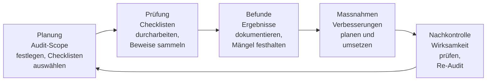
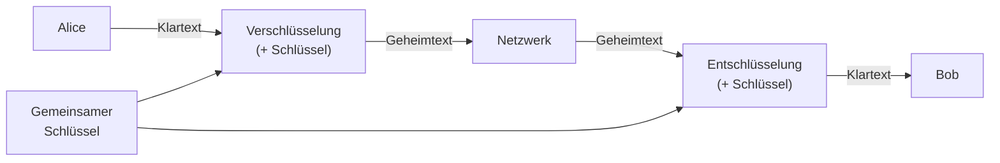
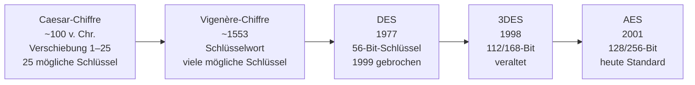

# Tag 06 - Checklisten & Verschlüsselung: Einstieg

<details>
  <summary>
	Block: Checklisten Datenschutzbeauftragter (LB3-Auftrag) (~45')
  </summary>

## Checklisten des Datenschutzbeauftragten

Der Datenschutzbeauftragte des Kantons Zürich stellt **Checklisten** bereit, mit denen Unternehmen und Organisationen ihre Datenschutz-Massnahmen prüfen können.

**Link:** https://www.datenschutz.ch/

---

### Der Audit-Prozess des Datenschutzbeauftragten



---

### Einstieg: Was prüft ein Datenschutzbeauftragter?

| Bereich | Typische Prüfpunkte |
|---|---|
| Datenkatalog | Welche Personendaten werden bearbeitet? Zu welchem Zweck? |
| Rechtsgrundlagen | Gibt es eine Einwilligung oder gesetzliche Grundlage? |
| Datensicherheit | Verschlüsselung, Zugriffsschutz, Backup |
| Betroffenenrechte | Können Betroffene Auskunft verlangen? |
| Drittländer | Werden Daten ins Ausland übermittelt? (Angemessenheit?) |
| Aufbewahrung | Werden Daten gelöscht, wenn sie nicht mehr gebraucht werden? |

---

### Beispiel einer ausgefüllten Checkliste (Auszug)

Die folgende Tabelle zeigt, wie eine korrekt dokumentierte Checkliste aussieht. Dieses Format verwenden Sie für den LB3-Auftrag.

**Checkliste: Website-Datenschutz (Muster-Ausfüllung)**

| # | Prüfpunkt | Einschätzung | Kommentar / Massnahme |
|---|---|:---:|---|
| 1 | Datenschutzerklärung vorhanden und aktuell | Erfüllt | Letzte Aktualisierung: 01.03.2024. Alle Pflichtangaben enthalten. |
| 2 | Cookie-Consent-Banner rechtskonform | Teilweise | «Ablehnen»-Button schwer auffindbar – muss gleichwertig platziert werden. |
| 3 | Third-Party-Dienste in Datenschutzerklärung erwähnt | Nicht erfüllt | Google Analytics wird nicht erwähnt. Sofortige Ergänzung notwendig. |
| 4 | Kontaktformular: Daten werden nur für Kontaktbearbeitung verwendet | Erfüllt | Zweckbindung korrekt. Keine Weitergabe an Dritte. |
| 5 | SSL/HTTPS auf allen Seiten aktiv | Erfüllt | Zertifikat gültig bis 12.2024. Erneuerung im Kalender vermerkt. |
| 6 | Aufbewahrungsfristen für Formulardaten definiert | Teilweise | Fristen festgelegt, aber nicht automatisiert – manuelle Löschung alle 6 Monate. |
| 7 | Verzeichnis der Verarbeitungstätigkeiten vorhanden | Nicht erfüllt | Noch nicht erstellt. Priorität: hoch (revDSG-Pflicht). |

**Reflexion zur Muster-Checkliste:**
> Die Prüfung zeigt, dass grundlegende Massnahmen (HTTPS, Datenschutzerklärung) vorhanden sind, aber Details wie der Cookie-Consent-Banner und das Verarbeitungsverzeichnis noch Nachbesserung erfordern. Besonders das Verarbeitungsverzeichnis ist eine revDSG-Pflicht und sollte priorisiert werden. Überraschend war, dass Third-Party-Dienste wie Analytics oft vergessen gehen, obwohl diese eine der grössten Datenschutzrisiken darstellen.

---

### Auftrag (LB3-Kriterium Nr. 4)

> Sozialform: Einzelarbeit
> Dauer: 20min (Rest als Hausaufgabe/LB3)
> Abgabe: Git-Repository (Markdown-Datei)

**Auftrag:**
1. Wählen Sie **zwei Checklisten** des Datenschutzbeauftragten (z. B. «Checkliste für Verantwortliche», «Checkliste Website»).
2. Bearbeiten Sie jede Checkliste und **dokumentieren Sie** Ihre Ergebnisse im Git-Repository.
3. Format: **Markdown-Tabelle** mit den Prüfpunkten und Ihrer Einschätzung (erfüllt / teilweise / nicht erfüllt).
4. Fügen Sie pro Checkliste eine **kurze Reflexion** (3–5 Sätze) hinzu: Was ist Ihnen aufgefallen? Was überrascht Sie?

**Mindestanforderung für LB3:**
- Zwei vollständig ausgefüllte Checklisten
- Je eine Reflexion
- Korrekte Markdown-Formatierung
- Im persönlichen Git-Repository abgelegt

</details>


<details>
  <summary>
	Block: Symmetrische Verschlüsselung (~50')
  </summary>

## Symmetrische Verschlüsselung

> 🤖 **Copilot-Agent:** [M231 T06a Symmetrisch](https://m365.cloud.microsoft/chat/?titleId=T_f040e8c0-daf2-1f1e-93c9-5db1fc779b13&source=embedded-builder) — mit dem TBZ-Konto öffnen und **Start** tippen.

Bei der **symmetrischen Verschlüsselung** wird **derselbe Schlüssel** zum Ver- und Entschlüsseln verwendet.



---

### Historische Verfahren

#### Caesar-Chiffre
Jeder Buchstabe wird um einen festen Wert verschoben.

| Klartext  | A | B | C | D | E | H | L | O |
|---|---|---|---|---|---|---|---|---|
| Schlüssel 3 | D | E | F | G | H | K | O | R |

**Beispiel:** `HALLO` → Schlüssel 3 → `KDOOR`

**Schwäche:** Nur 25 mögliche Schlüssel → leicht durch Brute Force zu knacken.

---

#### Vigenère-Chiffre

Beim Vigenère-Verfahren wird ein **Schlüsselwort** statt einer festen Zahl verwendet. Jeder Buchstabe des Klartexts wird um einen **anderen** Wert verschoben, der durch den entsprechenden Buchstaben des Schlüsselworts bestimmt wird.

**Schlüsselwort:** `SCHLUESSEL` (wird bei Bedarf wiederholt)

**Position im Alphabet:** A=0, B=1, C=2, … Z=25

**Ausführliches Beispiel:**

| Position       | 1  | 2  | 3  | 4  | 5  | 6  | 7  | 8  |
|----------------|----|----|----|----|----|----|----|----|
| **Klartext**   | D  | A  | T  | E  | N  | S  | C  | H  |
| **Schlüssel**  | S  | C  | H  | L  | U  | E  | S  | S  |
| Klartext-Nr.   | 3  | 0  | 19 | 4  | 13 | 18 | 2  | 7  |
| Schlüssel-Nr.  | 18 | 2  | 7  | 11 | 20 | 4  | 18 | 18 |
| Summe (mod 26) | 21 | 2  | 0  | 15 | 7  | 22 | 20 | 25 |
| **Geheimtext** | V  | C  | A  | P  | H  | W  | U  | Z  |

Jeder Klartextbuchstabe bekommt eine **andere** Verschiebung – daher scheitert die einfache Häufigkeitsanalyse zunächst.

**Schwäche:** Mit dem Kasiski-Test lässt sich die Schlüssellänge bestimmen, danach kann man jeden «Caesar-Abschnitt» separat brechen (→ nächster Block, Häufigkeitsanalyse).

---

### Entwicklung der symmetrischen Verschlüsselung



---

### Moderne symmetrische Verfahren

| Algorithmus | Schlüssellänge | Status |
|---|---|---|
| **DES** | 56 Bit | Unsicher (seit 1999 gebrochen) |
| **3DES** | 112/168 Bit | Veraltet, bald abgekündigt |
| **AES-128** | 128 Bit | Sicher |
| **AES-256** | 256 Bit | Sehr sicher, Standard |

**AES** (Advanced Encryption Standard) ist heute der Goldstandard für symmetrische Verschlüsselung. Er wurde 2001 vom US-amerikanischen NIST standardisiert und hat DES abgelöst.

---

### Das Schlüsselverteilungsproblem

**Problem:** Wie tauschen Alice und Bob den gemeinsamen Schlüssel sicher aus, wenn sie noch keine sichere Verbindung haben?

> Lösung: **Asymmetrische Verschlüsselung** (Tag 7)

---

### Transferaufgabe: Caesar entschlüsseln

> Sozialform: Einzelarbeit
> Dauer: 5min
> Abgabe: Plenum

Entschlüsseln Sie folgende Nachricht (Schlüssel = 13, sog. ROT13):
```
ZBURG VFG FPUJRVMREVFPU
```

*Tipp: ROT13 ist selbst-invers – Sie können die gleiche Operation zum Ver- und Entschlüsseln nutzen.*

**Bonusaufgabe:** Verschlüsseln Sie Ihren Vornamen mit dem Vigenère-Schlüsselwort `MODUL`. Tauschen Sie den Geheimtext mit der Nachbarperson aus und versuchen Sie, ihn zu entschlüsseln.

</details>


<details>
  <summary>
	Block: Häufigkeitsanalyse & Kryptoanalyse (~35')
  </summary>

## Häufigkeitsanalyse

> 🤖 **Copilot-Agent:** [M231 T06b Häufigkeitsanalyse](https://m365.cloud.microsoft/chat/?titleId=T_4a3db9dd-2ca9-39c9-4dac-88d26f629d5b&source=embedded-builder) — mit dem TBZ-Konto öffnen und **Start** tippen.

Die **Häufigkeitsanalyse** nutzt die statistische Verteilung von Buchstaben in einer Sprache, um verschlüsselte Texte zu knacken. Sie ist eines der ältesten kryptoanalytischen Werkzeuge und wurde bereits im 9. Jahrhundert vom arabischen Gelehrten Al-Kindi beschrieben.

### Buchstabenhäufigkeit Deutsch

Die folgende Tabelle zeigt die approximativen Häufigkeiten der häufigsten Buchstaben im Deutschen:

| Rang | Buchstabe | Häufigkeit | Visualisierung (relativ) |
|------|-----------|------------|--------------------------|
| 1 | **E** | ~17.5 % | ████████████████ |
| 2 | **N** | ~9.8 %  | █████████ |
| 3 | **I** | ~7.6 %  | ███████ |
| 4 | **S** | ~7.3 %  | ███████ |
| 5 | **R** | ~7.0 %  | ██████ |
| 6 | **A** | ~6.5 %  | ██████ |
| 7 | **T** | ~6.1 %  | █████ |
| 8 | **D** | ~5.1 %  | █████ |
| 9 | **H** | ~4.8 %  | ████ |
| 10 | **U** | ~4.4 % | ████ |

> **Merksatz:** Die häufigsten Buchstaben im Deutschen lassen sich mit **ENISRAT** merken.

---

### Schritt-für-Schritt: Eine Caesar-Chiffre knacken

**Geheimtext:**
```
GHU VFKOXVVHO LVW GUHL
```

**Schritt 1: Buchstaben zählen**

| Buchstabe | Anzahl |
|-----------|--------|
| H | 3 |
| V | 3 |
| U | 2 |
| G | 2 |
| L | 2 |
| W | 1 |
| F | 1 |
| K | 1 |
| O | 1 |
| X | 1 |
| I | 1 |

**Schritt 2: Häufigsten Buchstaben identifizieren**

`H` und `V` kommen je 3-mal vor. Im Deutschen ist `E` mit ~17.5 % am häufigsten.

**Schritt 3: Verschiebung berechnen**

Annahme: `H` (Position 7) entspricht `E` (Position 4)
Verschiebung: 7 − 4 = **3**

Probe: `V` (Position 21) − 3 = 18 = `S` → Das ist der zweithäufigste Buchstabe im Deutschen.

**Schritt 4: Gesamten Text entschlüsseln**

Schlüssel = 3: `GHU VFKOXVVHO LVW GUHL` → `DER SCHLUESSEL IST DREI`

---

### Der Kasiski-Test (für Vigenère)

Der **Kasiski-Test** (1863) ermöglicht es, die Schlüssellänge eines Vigenère-Chiffretexts zu bestimmen.

**Idee:** Wenn dieselbe Klartextsequenz zufällig mit demselben Teil des Schlüsselworts verschlüsselt wird, entsteht im Geheimtext eine **identische Zeichenfolge**. Der Abstand zwischen zwei gleichen Zeichenfolgen ist ein Vielfaches der Schlüssellänge.

**Vorgehen:**
1. Suchen Sie wiederkehrende Muster (min. 3 Zeichen) im Geheimtext.
2. Messen Sie die Abstände zwischen diesen Mustern.
3. Berechnen Sie den grössten gemeinsamen Teiler (ggT) der Abstände.
4. Das Ergebnis ist die wahrscheinliche Schlüssellänge.
5. Teilen Sie den Text in Gruppen auf (jede Gruppe = ein Caesar-Abschnitt).
6. Wenden Sie auf jede Gruppe die normale Häufigkeitsanalyse an.

---

### Schutz gegen Häufigkeitsanalyse

- **Längere Schlüssel** (Vigenère statt Caesar) – verteilen die Häufigkeiten
- **Blockchiffren** (AES) vermischen Zeichen über grosse Blöcke (Konfusion + Diffusion)
- **Padding:** Zufällige Zeichen werden hinzugefügt
- **Moderne Verfahren** wie AES sind vollständig resistent gegen Häufigkeitsanalyse

</details>


<details>
  <summary>
	Block: KI-Werkstatt 4 – KI generiert ein Chiffrat, Sie knacken es (~15')
  </summary>

## Eigenleistung geschützt: KI als Aufgabengeneratorin

Hier hat KI eine bewusst begrenzte Rolle: Sie darf Ihnen eine **Übungsaufgabe erzeugen** – das eigentliche Knacken bleibt Ihre Eigenleistung ohne KI-Hilfe.

---

### Übungsaufgabe

> Sozialform: Partnerarbeit
> Dauer: 15min
> Abgabe: Plenum

1. Bitten Sie eine KI, Ihnen einen **kurzen deutschen Satz (5–8 Wörter) mit einer Caesar-Chiffre** (beliebiger, Ihnen unbekannter Schlüssel zwischen 1 und 25) zu verschlüsseln. Lassen Sie sich nur den Geheimtext ausgeben, **nicht** den Schlüssel oder Klartext.
2. Knacken Sie das Chiffrat **von Hand** mittels Häufigkeitsanalyse (wie im vorherigen Block gezeigt) – ohne die KI weiter zu befragen.
3. Prüfen Sie Ihre Lösung: Bitten Sie die KI erst danach, den ursprünglichen Klartext und Schlüssel offenzulegen, und vergleichen Sie.
4. Diskutieren Sie mit Ihrer Partnerin/Ihrem Partner: Wo half die Häufigkeitsanalyse sofort, wo mussten Sie durch Ausprobieren nachhelfen (z. B. bei kurzen Texten mit wenig Statistik)?

> **Warum diese Übung so aufgebaut ist:** Die KI liefert nur das Ausgangsmaterial – die kryptoanalytische Eigenleistung (das eigentliche Lernziel dieses Blocks) bleibt bei Ihnen.

</details>
