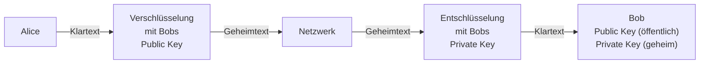
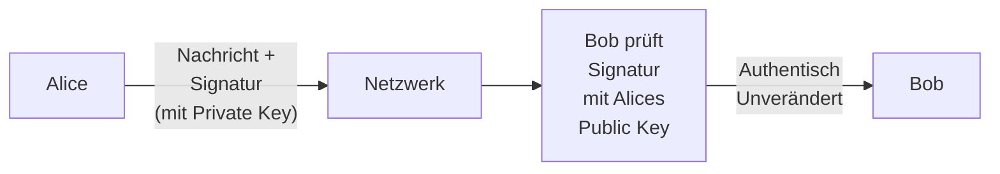
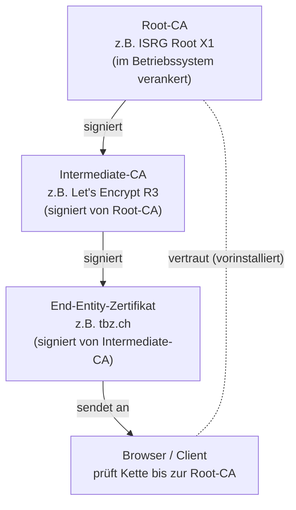
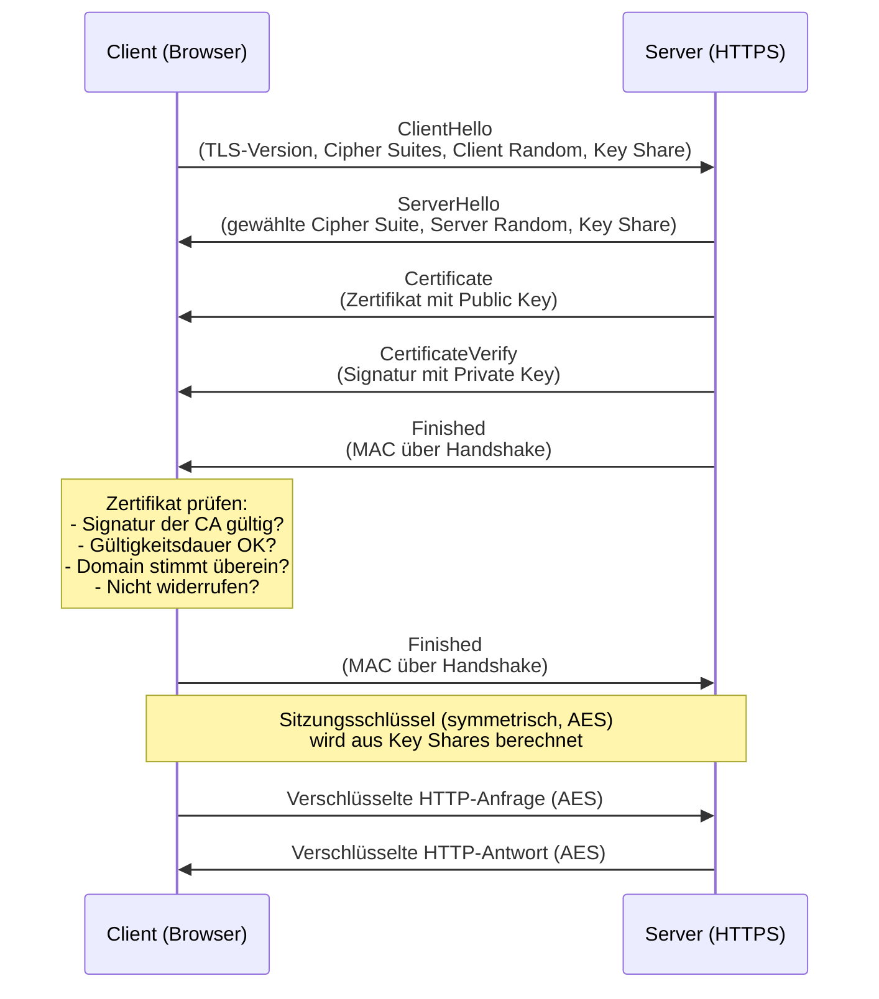
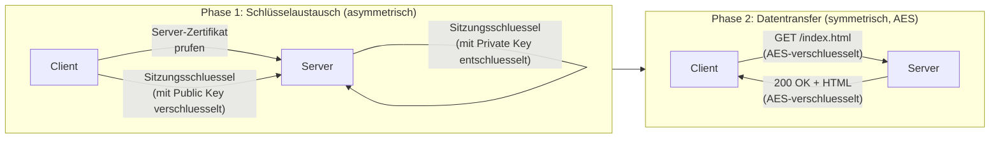
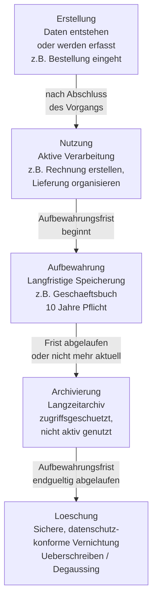

# Tag 07 - Asymmetrische Verschlüsselung & Dateiablagesysteme

<details>
  <summary>
	Block: Asymmetrische Verschlüsselung & PKI (~55')
  </summary>

## Asymmetrische Verschlüsselung

> 🤖 **Copilot-Agent:** [M231 T07a Asymmetrisch & PKI](https://m365.cloud.microsoft/chat/?titleId=T_d9850eec-8ebc-3bfe-f61e-9ab8ecccaaee&source=embedded-builder) — mit dem TBZ-Konto öffnen und **Start** tippen.

Bei der **asymmetrischen Verschlüsselung** gibt es **zwei mathematisch verbundene Schlüssel**:
- **Public Key (öffentlicher Schlüssel):** Kann frei verteilt werden. Wird zum Verschlüsseln verwendet.
- **Private Key (privater Schlüssel):** Muss geheim bleiben. Wird zum Entschlüsseln verwendet.



> **Merkregel:** Was mit dem Public Key verschlüsselt wurde, kann **nur** der Private Key entschlüsseln – und umgekehrt.

---

### Wichtige Konzepte

#### Digitale Signatur
Alice kann eine Nachricht mit ihrem **Private Key signieren**.
Bob kann mit Alices **Public Key** prüfen, dass die Nachricht wirklich von Alice stammt und nicht verändert wurde.



---

#### Gängige Algorithmen

| Algorithmus | Verwendung | Schlüssellänge |
|---|---|---|
| **RSA** | Verschlüsselung, Signaturen | 2048–4096 Bit |
| **ECC** | Verschlüsselung, Signaturen (effizienter) | 256–521 Bit |
| **DSA** | Nur Signaturen | 1024–3072 Bit |
| **Diffie-Hellman** | Schlüsselaustausch | Variabel |

---

### Public Key Infrastructure (PKI)

Die **PKI** ist ein System zur Verwaltung von digitalen Zertifikaten und öffentlichen Schlüsseln. Sie löst das zentrale Problem der asymmetrischen Kryptografie: Woher weiß ich, dass ein Public Key wirklich zu der Person/Organisation gehört, für die er ausgegeben wird?

#### Zertifikatskette (Chain of Trust)



**Komponenten der PKI:**
- **Root Certificate Authority (Root-CA):** Oberste Vertrauensinstanz, selbstsigniert, im Betriebssystem/Browser vorinstalliert
- **Intermediate-CA:** Zwischenzertifizierungsstelle, signiert von der Root-CA, stellt Endnutzer-Zertifikate aus
- **Digitales Zertifikat (X.509):** Bindet Public Key an Identität (Domain, Person, Organisation). Enthält: Inhabername, Public Key, Aussteller, Gültigkeitsdauer, Seriennummer, Signatur der CA
- **Certificate Revocation List (CRL) / OCSP:** Mechanismen um ungültige Zertifikate zu kennzeichnen

---

### TLS 1.3 Handshake

Beim Aufbau einer HTTPS-Verbindung findet ein **TLS 1.3 Handshake** statt. Dieser ist schneller als frühere Versionen (nur 1 Round-Trip statt 2).



---

### Vergleich: Symmetrisch vs. Asymmetrisch

| | Symmetrisch | Asymmetrisch |
|---|---|---|
| Schlüssel | Ein gemeinsamer | Public + Private Key |
| Geschwindigkeit | Sehr schnell | Langsam |
| Schlüsselverteilung | Problematisch | Einfach (Public Key) |
| Verwendung | Datenverschlüsselung | Schlüsselaustausch, Signaturen |
| Algorithmen | AES, 3DES | RSA, ECC |
| Einsatz | Nach Schlüsselaustausch | TLS-Handshake, PGP |

> In der Praxis: **Hybridverschlüsselung** = asymmetrisch für Schlüsselaustausch + symmetrisch für Daten (nächster Block).

</details>


<details>
  <summary>
	Block: Hybridverschlüsselung im Alltag (~35')
  </summary>

## Hybridverschlüsselung – das Beste aus beiden Welten

> 🤖 **Copilot-Agent:** [M231 T07b Hybrid](https://m365.cloud.microsoft/chat/?titleId=T_5db67ea1-0f89-9b86-1420-c5b75fc51976&source=embedded-builder) — mit dem TBZ-Konto öffnen und **Start** tippen.

In der Praxis verwendet man **nie** nur symmetrische oder nur asymmetrische Verschlüsselung. Stattdessen kombiniert man beide Verfahren: das nennt man **Hybridverschlüsselung**.

**Warum?**
- Asymmetrisch: sicherer Schlüsselaustausch, aber sehr langsam (1000× langsamer als AES)
- Symmetrisch: sehr schnell, aber das Schlüsselverteilungsproblem
- Hybrid: Man nutzt asymmetrische Kryptografie nur für den **Schlüsselaustausch**, danach wird mit dem ausgetauschten symmetrischen Schlüssel die eigentliche Kommunikation verschlüsselt.



---

## Verschlüsselung im Berufsalltag

Verschlüsselung begegnet uns täglich – oft ohne dass wir es bewusst wahrnehmen.

### Übersicht: Alltagsanwendungen

| Anwendung | Verschlüsselungstyp | Algorithmus(en) | Wozu |
|---|---|---|---|
| **HTTPS (Websites)** | Hybrid | TLS 1.3 (ECDHE + AES-256-GCM) | Vertraulichkeit & Integrität der Webkommunikation |
| **Verschlüsselte E-Mail (S/MIME / PGP)** | Hybrid | RSA / ECC + AES | Vertrauliche E-Mails, digitale Signatur |
| **VPN** | Symmetrisch (nach Handshake) | TLS oder IPsec (AES) | Sicherer Tunnel ins Firmennetz |
| **Verschlüsselte Festplatte (BitLocker / FileVault)** | Symmetrisch | AES-256 | Schutz bei Diebstahl des Geräts |
| **WhatsApp / Signal** | Hybrid + End-to-End | Signal-Protokoll (Curve25519 + AES) | Nur Sender & Empfänger lesen die Nachricht |
| **SSH** | Hybrid | ECDHE + AES | Sicherer Fernzugang zu Servern |
| **Digitale Signatur (PDF)** | Asymmetrisch | RSA / ECC | Echtheit und Unveränderlichkeit von Dokumenten |

### Vertiefung: End-to-End-Verschlüsselung (E2EE)

Bei **End-to-End-Verschlüsselung** (wie bei Signal oder WhatsApp) wird die Nachricht auf dem Gerät des Absenders verschlüsselt und erst auf dem Gerät des Empfängers entschlüsselt. Der Dienstanbieter kann den Inhalt **nicht lesen** – er sieht nur verschlüsselte Datenpakete.

> **Wichtig für den Datenschutz:** E2EE schützt die Kommunikation auch bei einem Angriff auf den Server des Anbieters.

</details>


<details>
  <summary>
	Block: Dateiablagesysteme & Ordnungsprinzipien (~50')
  </summary>

## Dateiablagesysteme

> 🤖 **Copilot-Agent:** [M231 T07c Dateiablage](https://m365.cloud.microsoft/chat/?titleId=T_8369103e-d000-63d4-8c35-78b41f01c9b8&source=embedded-builder) — mit dem TBZ-Konto öffnen und **Start** tippen.

Ein gutes Ablagesystem hilft, Daten **schnell zu finden**, **sicher aufzubewahren** und **Verluste zu vermeiden**.

### Ordnungsprinzipien

| Prinzip | Beschreibung | Beispiel |
|---|---|---|
| **Alphabetisch** | Nach A–Z sortiert | Kundendossiers nach Nachnamen |
| **Chronologisch** | Nach Datum sortiert | Rechnungen nach Jahr/Monat |
| **Hierarchisch** | Thematisch gegliedert, von allgemein zu spezifisch | Projekte → Projekt A → Dokumente |
| **Funktional** | Nach Aufgabe/Abteilung | HR, Finanzen, IT |

---

### Dateinamenskonventionen

**Gute Dateinamen sind:**
- Ohne Sonderzeichen und Leerzeichen (stattdessen `_` oder `-`)
- Mit Datumsformat: `JJJJ-MM-TT` (ISO 8601) für chronologische Sortierung
- Aussagekräftig und konsistent

**Beispiele:**
```
Schlecht: Rechnung endgültig final V3 NEU.pdf
Gut:      2025-09-15_Rechnung_MusterAG_RE2025-042.pdf

Schlecht: mein foto.jpg
Gut:      2025-08-20_Ferien_Zermatt_001.jpg
```

---

### Ordnerstruktur für ein Schulprojekt

```
m231-lernportfolio/
├── README.md
├── 01_Lernjournal/
│   ├── 2025-08-18_Tag1.md
│   ├── 2025-08-25_Tag2.md
│   └── ...
├── 02_Auftraege/
│   ├── LB3_Checkliste1.md
│   └── LB3_Checkliste2.md
├── 03_Zusammenfassungen/
│   ├── Verschluesselung.md
│   └── Datenschutzrecht.md
└── 04_Ressourcen/
    └── img/
```

---

### Daten-Lebenszyklus

Jede Datei durchläuft mehrere Phasen von der Entstehung bis zur Löschung. Das **Lebenszyklusmanagement** stellt sicher, dass Daten nur so lange aufbewahrt werden wie nötig (Datensparsamkeit, Art. 6 revDSG).



**Aufbewahrungsfristen (Schweiz, Auswahl):**
- Geschäftsbücher / Buchungsbelege: **10 Jahre** (OR Art. 958f)
- Personalakten: **10 Jahre** nach Austritt
- E-Mails mit Geschäftswert: **10 Jahre**
- Patientendossiers: **10–20 Jahre** (je nach Kanton)

**Sichere Datenlöschung:**
- Einfaches «Löschen» oder «Papierkorb leeren» genügt **nicht** (Daten bleiben auf der Festplatte, nur der Index-Eintrag wird entfernt)
- Methoden: **Überschreiben** (z. B. NIST 800-88, mind. 1-3 Durchgänge), **physische Zerstörung**, **Degaussing** (Entmagnetisierung bei Magnetfestplatten), **Crypto Erase** (bei SSDs: Schlüssel löschen)

---

### Cloud vs. lokale Ablage

| Kriterium | Lokale Ablage | Cloud-Ablage |
|---|---|---|
| **Zugänglichkeit** | Nur vor Ort / im Netzwerk | Überall, jedes Gerät |
| **Kosten** | Einmalige Hardwarekosten | Laufende Abo-Kosten |
| **Skalierbarkeit** | Begrenzt, Erweiterung kostspielig | Flexibel skalierbar |
| **Datenschutz** | Volle Kontrolle über Daten | Abhängig vom Anbieter, Rechtsdomizil! |
| **Backup** | Eigene Verantwortung | Meist inkludiert (aber prüfen!) |
| **Verfügbarkeit** | Abhängig von lokaler Infrastruktur | Abhängig von Internetverbindung |
| **Compliance** | Einfach kontrollierbar | CH-Daten in US-Cloud? CLOUD Act! |

> **Wichtig für den Datenschutz:** Wenn Personendaten in eine Cloud ausserhalb der Schweiz oder des EWR übertragen werden, braucht es eine gesetzliche Grundlage (z. B. Standardvertragsklauseln). US-Cloud-Dienste unterliegen dem **CLOUD Act**, was bedeutet, dass US-Behörden theoretisch Zugriff auf Daten verlangen können.

---

### Transferaufgabe: Optimale Ordnerstruktur

> Sozialform: Partnerarbeit
> Dauer: 10min
> Abgabe: Plenum (Bildschirm teilen oder Skizze zeigen)

**Szenario:** Sie arbeiten in einem KMU (10 Mitarbeitende, Heizungsmontagen). Das Unternehmen hat folgende Dokumenttypen:
- Kundenrechnungen (mehrere pro Monat, 10 Jahre Aufbewahrung)
- Fotos der Montageobjekte (pro Auftrag 5–20 Fotos)
- Lieferantenverträge (wenige, aber langfristig relevant)
- Personalunterlagen (pro Mitarbeiter)
- Marketingmaterial (Flyer, Logo-Varianten)

1. Entwerfen Sie eine hierarchische Ordnerstruktur mit sinnvollen Dateinamenskonventionen.
2. Berücksichtigen Sie die Aufbewahrungsfristen.
3. Welche Ordner würden Sie in der Cloud ablegen, welche lokal? Begründen Sie.

</details>


<details>
  <summary>
	Block: LB3-Checkpoint – Passwortverwaltung & Auskunftsbegehren (~40')
  </summary>

## LB3 – Checkpoint

> Sozialform: Einzelarbeit / individuelle Checkpoint-Gespräche mit Lehrperson
> Dauer: ~40 Minuten

---

### Passwortverwaltung: Kriterien für die Auswahl (Kriterium 2 & 3)

Vergleichen Sie mindestens zwei Passwort-Manager anhand der folgenden Kriterien:

| Kriterium | Beschreibung | Warum wichtig |
|---|---|---|
| **Verschlüsselung** | Welcher Algorithmus? Wo werden Daten gespeichert (lokal/Cloud)? | Kernfunktion des Datenschutzes |
| **Open Source** | Ist der Quellcode einsehbar und geprüft? | Vertrauenswürdigkeit, keine Backdoors |
| **2FA-Unterstützung** | Kann der Tresor selbst mit 2FA gesichert werden? | Schutz bei Passwort-Leak |
| **Plattformunterstützung** | Windows, macOS, Linux, iOS, Android, Browser-Plugin? | Alltagstauglichkeit |
| **Preis / Lizenzmodell** | Kostenlos, Freemium, Abo? | Nachhaltigkeit |
| **Import/Export** | Können Passwörter exportiert werden? | Datenhaltigkeit, kein Vendor Lock-in |
| **Passwort-Generator** | Ist ein Generator integriert? | Sicherheit neuer Passwörter |
| **Sicherheitsaudit** | Wurde der Manager von Dritten geprüft? | Vertrauenswürdigkeit |

**Empfohlene Produkte zum Vergleich:** Bitwarden, KeePassXC, 1Password, Dashlane, NordPass

**Vorgehen für LB3:**
1. Wählen Sie mind. 2 Produkte.
2. Füllen Sie die Kriterienliste mit echten Informationen aus (Screenshots als Nachweis).
3. Schreiben Sie eine begründete Empfehlung (mind. 3 Sätze).
4. Installieren Sie den gewählten Manager und zeigen Sie der Lehrperson die Installation und grundlegende Nutzung (Checkpoint-Gespräch).

---

### Auskunftsbegehren schreiben (Kriterium 5)

Ein **Auskunftsbegehren** ist Ihr Recht nach Art. 25 revDSG (Schweiz) bzw. Art. 15 DSGVO (EU): Sie können von jedem Unternehmen verlangen zu wissen, welche Daten über Sie gespeichert sind.

**Schritt-für-Schritt-Anleitung:**

1. **Unternehmen wählen:** Wählen Sie ein reales Unternehmen (oder verwenden Sie die Vorlage der Lehrperson für eine fiktive Übung).

2. **Betreff formulieren:**
   ```
   Betreff: Auskunftsbegehren gemäss Art. 25 revDSG
   ```

3. **Inhalt des Schreibens:**
   - Vollständiger Name und Adresse
   - Klare Anfrage: Welche Personendaten werden gespeichert?
   - Anfrage nach Zweck, Herkunft, Empfängern und Aufbewahrungsdauer
   - Bitte um Antwort innert 30 Tagen (gesetzliche Frist)

4. **Identitätsnachweis:**
   - Kopie eines Ausweisdokuments **nur wenn** das Unternehmen Zweifel an Ihrer Identität hat und ausdrücklich darum bittet
   - **Hinweis:** Keine ID unaufgefordert mitsenden!

5. **Als Brief gestalten:** Absender, Empfänger, Ort/Datum, Betreff, Inhalt und Unterschrift. Der Brief wird nicht verschickt (ausser Sie möchten ihn freiwillig an ein echtes Unternehmen senden).

6. **Für LB3:** Brief als **PDF in Ihrem Git-Repository** ablegen und im README verlinken. Ist Ihr Repository öffentlich, Privatadresse und Geburtsdatum schwärzen oder fiktiv angeben.

**Vorlage:** edöb.ch → Dokumentation → Musterbrief Auskunftsbegehren

---

### Checkpoint-Gespräch mit Lehrperson

Die Lehrperson führt individuelle Kurz-Checkpoints (3–5 Minuten) durch. Bereiten Sie folgende Punkte vor:

| Punkt | Ihre Antwort (vorbereiten) |
|---|---|
| Link zum Git-Repository | |
| Aktueller Stand Passwortverwaltung | |
| Status Auskunftsbegehren | |
| Anzahl Lernjournal-Einträge | |
| Grösste offene Frage / Problem | |

---

### Lernjournal-Eintrag Tag 7

Halten Sie fest:
- Was war Ihnen bei asymmetrischer Verschlüsselung, PKI und Hybridverschlüsselung neu oder noch unklar?
- Was haben Sie für LB3 heute erarbeitet (Passwortverwaltung, Auskunftsbegehren)?
- Was sind Ihre nächsten Schritte bis zum LB3-Abgabetermin (Tag 9)?

</details>
