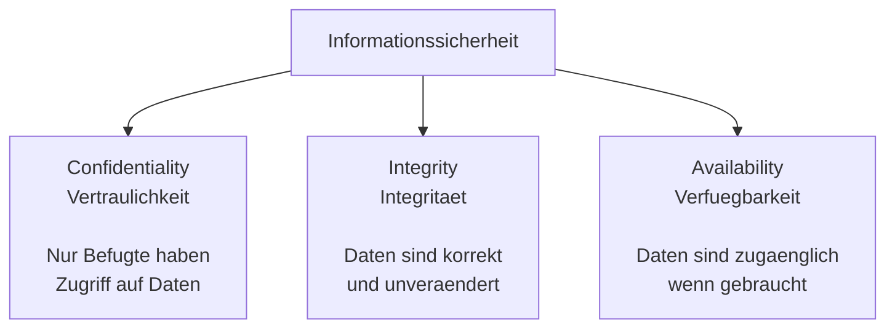
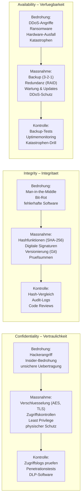
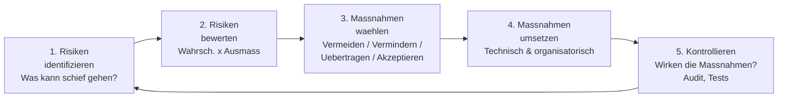
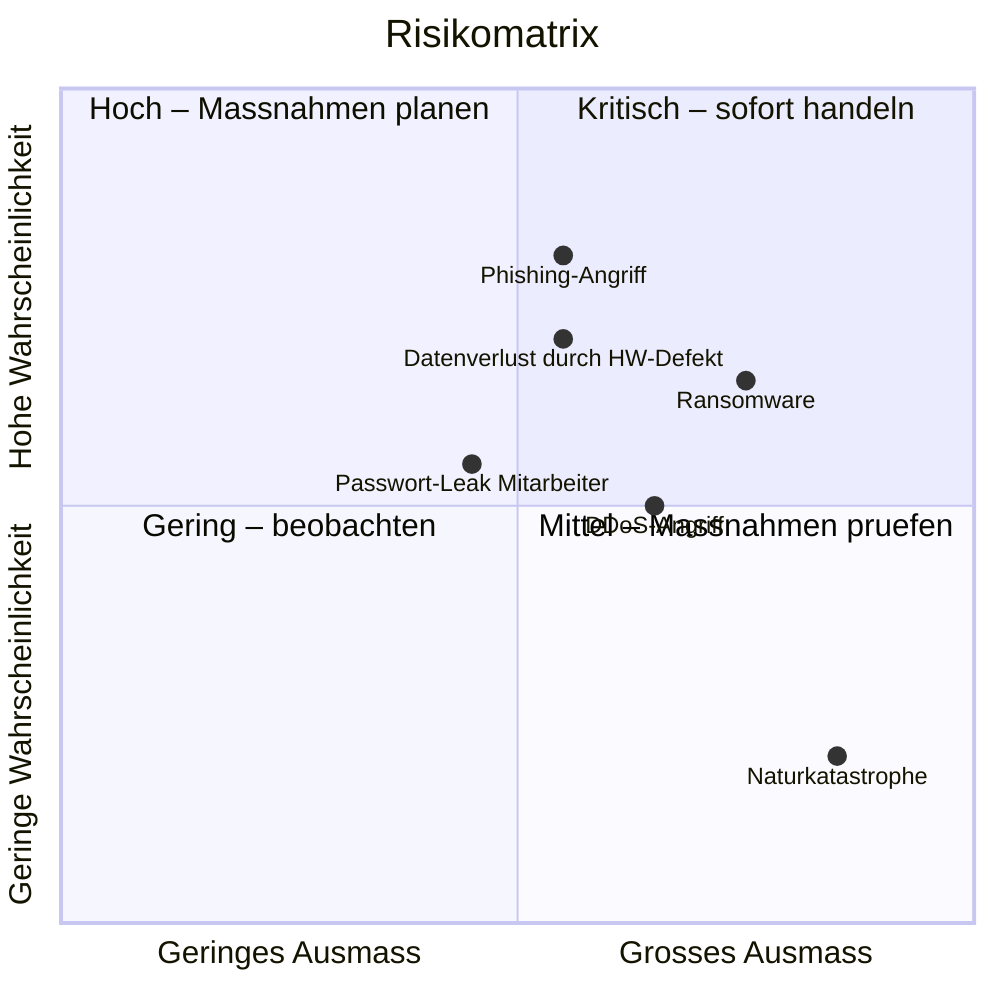
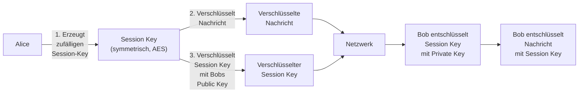
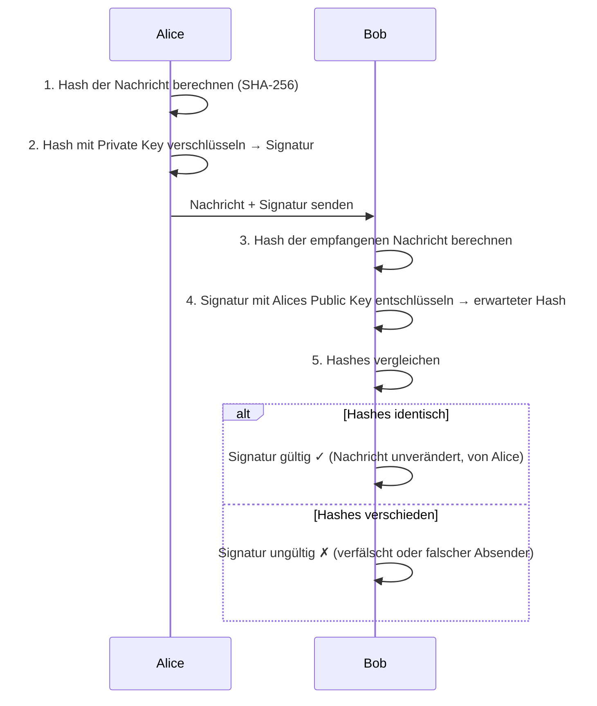
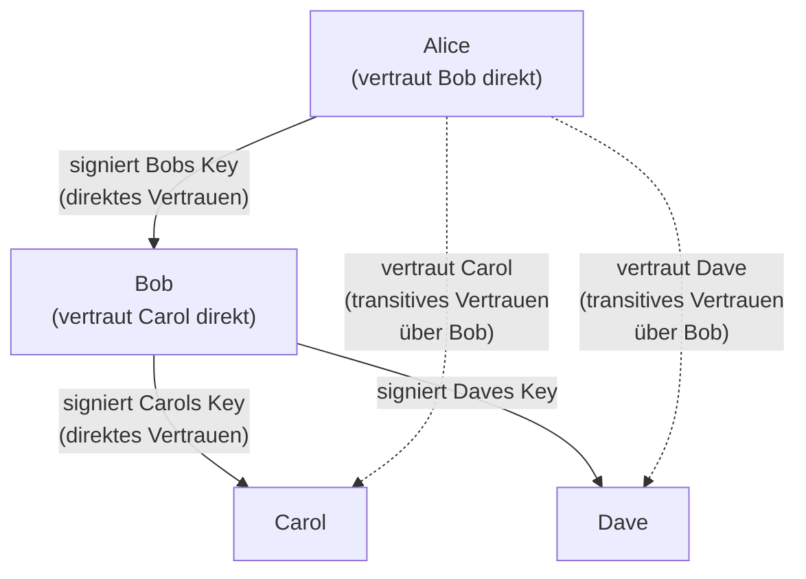

# Tag 08 - CIA-Prinzip, Risikomanagement & PGP

<details>
  <summary>
	Block: CIA-Prinzip & Informationssicherheit – Vertiefung (~60')
  </summary>

## Das CIA-Prinzip (Schutzziele der Informationssicherheit)

> 🤖 **Copilot-Agent:** [M231 T08a CIA-Prinzip](https://m365.cloud.microsoft/chat/?titleId=T_3abe5f98-7654-e12b-0e74-ba727277abfa&source=embedded-builder) — mit dem TBZ-Konto öffnen und **Start** tippen.

> Repetition aus [Tag 3](tag-03.md): Heute vertiefen wir mit Bedrohung → Massnahme → Kontrolle und Fallstudien. Aufgaben: **Arbeitsblatt Tag 8, Teil A**.



---

### CIA im Überblick: Bedrohung → Massnahme → Kontrolle



---

### Confidentiality – Vertraulichkeit

**Ziel:** Daten dürfen nur von autorisierten Personen gelesen/verwendet werden.

**Massnahmen:**
- Verschlüsselung (AES, TLS)
- Zugriffskontrollen (Rollen, Least Privilege)
- Physischer Schutz (abgeschlossene Serverräume)
- Datensparsamkeit (nur nötige Daten erheben)

**Bedrohungen:** Hackerangriffe, Insider-Bedrohungen, unsichere Übertragung

---

### Integrity – Integrität

**Ziel:** Daten dürfen nicht unbemerkt verändert werden.

**Massnahmen:**
- Hashfunktionen (SHA-256): Fingerabdruck der Datei
- Digitale Signaturen
- Versionierung (Git!)
- Prüfsummen bei Downloads

**Bedrohungen:** Man-in-the-Middle, Bit-Rot, fehlerhafte Software

**Beispiel Hashfunktion:**
```
SHA-256("Hallo") = 185f8db32...
SHA-256("hallo") = 2cf24dba5...
```
Selbst kleinste Änderungen erzeugen einen komplett anderen Hash.

---

### Availability – Verfügbarkeit

**Ziel:** Systeme und Daten sind verfügbar wenn sie gebraucht werden.

**Massnahmen:**
- Backup (3-2-1-Regel → Tag 9)
- Redundanz (RAID, redundante Netzwerkverbindungen)
- Wartung und Updates
- DDoS-Schutz

**Bedrohungen:** DDoS-Angriffe, Ransomware, Hardware-Ausfall, Katastrophen

---

### Fallstudie: Der verlorene Laptop

**Szenario:** Ein Arzt verliert seinen unverschlüsselten Laptop. Darauf befinden sich Patientendossiers von 800 Patienten (Name, Diagnose, Medikamente). Beim Bahnhof gefunden und der Presse übergeben.

**Analyse: Welche CIA-Ziele sind verletzt?**

| CIA-Ziel | Verletzt? | Begründung |
|---|---|---|
| **Confidentiality** | Ja, schwerwiegend | Patientendaten (besonders schützenswert!) für Unbefugte zugänglich |
| **Integrity** | Potenziell | Daten könnten manipuliert worden sein (keine Nachweismöglichkeit) |
| **Availability** | Ja | Der Arzt kann nicht auf seine Daten zugreifen (Praxisbetrieb gestört) |

**Rechtliche Folgen:**
- Meldepflicht an den EDÖB (Schweiz) innert 72h bei hohem Risiko (Art. 24 revDSG)
- Benachrichtigung der betroffenen Patienten
- Mögliche Busse bis CHF 250'000

**Präventive Massnahmen:**
- Vollverschlüsselung des Laptops (BitLocker / FileVault) → Confidentiality
- Starkes Anmeldepasswort + MFA → Confidentiality
- Regelmässiges Backup → Availability
- Hashprüfung bei Datenbankupdates → Integrity

---

### Reale Beispiele für CIA-Verletzungen

| CIA-Ziel | Beispiel-Verletzung | Konkrete Ursache |
|---|---|---|
| **Confidentiality** | Datenleck bei einem Online-Shop (Kreditkartendaten gestohlen) | SQL-Injection-Angriff, Daten unverschlüsselt gespeichert |
| **Confidentiality** | Mitarbeiter liest Patientendossiers ohne medizinischen Grund | Fehlende Zugriffskontrollen (kein Least Privilege) |
| **Integrity** | Software-Update enthält Trojaner (SolarWinds 2020) | Kompromittierter Build-Prozess des Herstellers |
| **Integrity** | Webseite zeigt manipulierte Preise | Ungeprüfte Nutzereingaben (keine Input-Validation) |
| **Availability** | Spital-IT durch Ransomware verschlüsselt | Fehlende Backups, veraltete Software |
| **Availability** | Online-Shop stundenlang nicht erreichbar (DDoS) | Kein DDoS-Schutz, keine Redundanz |

---

### Erweiterungen des CIA-Modells

| Erweiterung | Bedeutung |
|---|---|
| **Non-Repudiation** | Unleugbarkeit – niemand kann Aktionen abstreiten (Protokollierung, Signaturen) |
| **Authenticity** | Echtheit – Daten stammen wirklich vom angegebenen Absender |
| **Accountability** | Nachvollziehbarkeit – wer hat was wann gemacht? (Audit-Logs) |

---

### Kurzfallstudien: CIA in der Praxis

> Sozialform: Partnerarbeit
> Dauer: 10min
> Abgabe: Plenum

Analysieren Sie in Zweiergruppen je eine Fallstudie: Welches CIA-Ziel ist primär/sekundär verletzt? Welche technischen/organisatorischen Massnahmen hätten geholfen?

**Fallstudie Bank:** Eine Kantonalbank betreibt ihr Online-Banking-System. Während einer Wartungsarbeit wird versehentlich eine falsche Datenbank-Version eingespielt. Kundensalden aus dem Vormonat werden angezeigt. Das System ist 4 Stunden nicht erreichbar.

**Fallstudie Spital:** In einem Spital werden Patientenakten auf einem unverschlüsselten Laptop gespeichert. Der Laptop wird gestohlen. Das Spital hat keine Verschlüsselung und kein MDM (Mobile Device Management) eingesetzt.

</details>


<details>
  <summary>
	Block: Risikomanagement (~45')
  </summary>

## Risikomanagement

> 🤖 **Copilot-Agent:** [M231 T08b Risikomanagement](https://m365.cloud.microsoft/chat/?titleId=T_d44cbb02-b828-3217-987c-44ffb650a0cf&source=embedded-builder) — mit dem TBZ-Konto öffnen und **Start** tippen.

### Grundformel

> **Risiko = Eintrittswahrscheinlichkeit × Schadensausmass**

---

### Risikomanagement-Prozess

Risikomanagement ist kein einmaliger Vorgang, sondern ein **kontinuierlicher Kreislauf**:



---

### Risikomatrix (visuell)

Die **Risikomatrix** ordnet Risiken nach Eintrittswahrscheinlichkeit und Schadensausmass ein:



**Farblegende:**
- **Kritisch (oben rechts):** Sofortiger Handlungsbedarf, höchste Priorität
- **Hoch:** Massnahmen zeitnah planen und umsetzen
- **Mittel:** Massnahmen prüfen, Situation beobachten
- **Gering (unten links):** Akzeptieren oder mit geringem Aufwand adressieren

---

### Risikostrategien

| Strategie | Beschreibung | Beispiel |
|---|---|---|
| **Vermeiden** | Risikoauslösende Aktivität einstellen | Keine Kundendaten unnötig in die Cloud laden |
| **Vermindern** | Massnahmen ergreifen, um Wahrscheinlichkeit oder Ausmass zu reduzieren | Verschlüsselung, MFA, Backups |
| **Übertragen** | Risiko auf Dritte verlagern | Cyber-Versicherung, Outsourcing an zertifizierten Dienstleister |
| **Akzeptieren** | Risiko bewusst und dokumentiert tragen | Kleines Risiko, Massnahmen wären unverhältnismässig teuer |

---

### Typische IT-Risiken und Massnahmen

| Risiko | Bedrohung | Eintritts-Wahrsch. | Ausmass | Massnahme |
|---|---|:---:|:---:|---|
| Datenverlust | Hardware-Defekt, Feuer | Mittel | Hoch | Backup (3-2-1-Regel) |
| Datenpanne | Hackerangriff, Fehlkonfiguration | Hoch | Hoch | Verschlüsselung, Firewall, Zugriffskontrollen |
| Systemausfall | DDoS, Ransomware | Mittel | Hoch | Redundanz, Backup, Incident Response Plan |
| Social Engineering | Phishing | Hoch | Mittel | Schulung, Prozesse, technische Filter |
| Physischer Diebstahl | Laptop gestohlen | Mittel | Mittel–Hoch | Geräteverschlüsselung, MDM-Remote-Wipe |

---

### Transferaufgabe

> Sozialform: Partnerarbeit
> Dauer: 15min (Arbeitsblatt Teil B)
> Abgabe: Plenum

**Szenario:** Ein kleines Unternehmen (15 Mitarbeitende) speichert Kundendaten auf einem **lokalen Server ohne Backup**. Die Mitarbeitenden arbeiten teils im Homeoffice und verbinden sich über ungesicherte WLAN-Verbindungen. Alle nutzen dasselbe Admin-Passwort für den Server.

**Aufgaben:**
1. Identifizieren Sie **mindestens 4 Risiken** in diesem Szenario.
2. Schätzen Sie für jedes Risiko Eintrittswahrscheinlichkeit (hoch/mittel/gering) und Schadensausmass (hoch/mittel/gering) ein.
3. Tragen Sie die Risiken in eine eigene Risikomatrix ein (Skizze genügt).
4. Wählen Sie für jedes Risiko eine Strategie (Vermeiden/Vermindern/Übertragen/Akzeptieren) und nennen Sie je eine **konkrete Massnahme**.
5. Welches Risiko hat die höchste Priorität? Begründen Sie.

**Musterlösung (Lehrperson):**
- Datenverlust durch Server-Defekt: Hohe Wahrsch., hohes Ausmass → Vermindern: 3-2-1-Backup einrichten
- Datenabfluss via ungesichertes WLAN: Hohe Wahrsch., hohes Ausmass → Vermindern: VPN-Pflicht im Homeoffice
- Kompromittierung des Admin-Passworts: Hohe Wahrsch., kritisches Ausmass → Vermindern: Individuelle Passwörter, MFA, Least Privilege
- Ransomware: Mittlere Wahrsch., kritisches Ausmass → Vermindern: Offline-Backup, Endpoint Protection, Updates

</details>


<details>
  <summary>
	Block: Asymmetrische Verschlüsselung vertieft – PGP (~70')
  </summary>

## PGP – Pretty Good Privacy

> 🤖 **Copilot-Agent:** [M231 T08c PGP](https://m365.cloud.microsoft/chat/?titleId=T_7bc6a6a5-fa1c-9ec8-ba68-4d810935ad5a&source=embedded-builder) — mit dem TBZ-Konto öffnen und **Start** tippen.

**PGP** ist ein Verschlüsselungsprogramm für E-Mails und Dateien. Es basiert auf asymmetrischer Verschlüsselung und verwendet das **Web of Trust** als Alternative zur PKI (Public Key Infrastructure).

### Wie PGP eine E-Mail verschlüsselt



> **PGP = Hybridverschlüsselung:** Asymmetrisch für den Schlüsselaustausch, symmetrisch (AES) für die Daten.

---

### PGP-Signatur – Verifikationsprozess

Alice kann eine Nachricht **signieren**, um Authentizität und Integrität zu beweisen:



**Nachweis:** Die Nachricht stammt von Alice (Authentizität) und wurde nicht verändert (Integrität).

---

### Web of Trust – Vertrauensnetz ohne zentrale Autorität

Im Gegensatz zur PKI (mit Certificate Authority) baut PGP auf ein dezentrales **Web of Trust**: Nutzer signieren gegenseitig die Schlüssel von Personen, denen sie persönlich begegnet sind.



**Funktionsweise:**
- Alice kennt Bob persönlich → sie signiert seinen Public Key
- Bob kennt Carol persönlich → er signiert ihren Public Key
- Alice vertraut Bobs Urteil → Alice kann Carols Key als vertrauenswürdig einstufen (transitiv)
- Keyserver (z. B. keys.openpgp.org) speichern Public Keys und Signaturen öffentlich

**Fingerprint:** Kurzer Hash des Public Keys zur persönlichen Verifikation (z. B. am Telefon vorlesen):
```bash
gpg --fingerprint alice@example.ch
```

---

### PKI vs. Web of Trust – Vergleich

| Merkmal | PKI (z. B. TLS-Zertifikate) | Web of Trust (PGP) |
|---|---|---|
| **Vertrauensanker** | Zentrale Certificate Authority (CA) | Dezentral: Nutzer signieren sich gegenseitig |
| **Verifikation** | CA prüft Identität, stellt Zertifikat aus | Nutzer prüft Identität persönlich |
| **Skalierbarkeit** | Gut (automatisiert, grosse Systeme) | Eingeschränkt (manueller Prozess) |
| **Single Point of Failure** | Ja (kompromittierte CA = Problem) | Nein (kein zentraler Angriffspunkt) |
| **Anwendung** | HTTPS, S/MIME, Code Signing | E-Mail-Verschlüsselung (PGP/GPG) |
| **Vertrauen auf Basis von** | Institutionen (Browser-Hersteller) | Persönlichen Beziehungen |
| **Zertifikatswiderruf** | CRL / OCSP (automatisch) | Key Revocation Certificate (manuell) |

---

### PGP in der Praxis – GPG-Befehle (LB3-Kriterium Nr. 6)

> **Auftrag:** Senden Sie eine PGP-verschlüsselte E-Mail an die Lehrperson.

**Installation:**
- Windows: **gpg4win** (inkl. Kleopatra als GUI)
- macOS: **GPG Suite** (gpgtools.org)
- Linux: GPG ist vorinstalliert

**Schritt-für-Schritt:**

**1. Schlüsselpaar erstellen:**
```bash
gpg --gen-key
# Interaktiv: Name und E-Mail-Adresse eingeben, Passphrase wählen
```

**2. Eigene Schlüssel auflisten:**
```bash
gpg --list-keys          # Alle bekannten Public Keys
gpg --list-secret-keys   # Eigene Private Keys
```

**3. Public Key exportieren und an Lehrperson senden:**
```bash
gpg --armor --export ihre@email.ch > mein_publickey.asc
# Datei als Anhang per E-Mail senden
```

**4. Public Key der Lehrperson importieren:**
```bash
gpg --import lehrperson_publickey.asc
```

**5. Importierten Key als vertrauenswürdig markieren:**
```bash
gpg --edit-key lehrperson@tbz.ch
# Im GPG-Prompt: trust → 5 (ultimate) oder 4 (full) → quit
```

**6. Nachricht verschlüsseln und signieren:**
```bash
gpg --encrypt --sign --armor --recipient lehrperson@tbz.ch nachricht.txt
# Erzeugt: nachricht.txt.asc
```

**7. Signatur einer Datei prüfen:**
```bash
gpg --verify datei.asc
# Ausgabe zeigt: Good signature from "Alice <alice@example.ch>"
```

**8. Verschlüsselte Datei entschlüsseln:**
```bash
gpg --decrypt nachricht.txt.asc
```

---

### Transferaufgabe

> Sozialform: Einzelarbeit, danach Partnerarbeit (Arbeitsblatt Teil C)
> Dauer: 50 min
> Abgabe: LB3 (bis Tag 9)

Richten Sie GPG auf Ihrem Gerät ein, erstellen Sie Ihr Schlüsselpaar und senden Sie Ihren Public Key an die Lehrperson. Verschlüsseln Sie anschliessend eine kurze Testnachricht mit dem Public Key der Lehrperson und senden Sie diese per E-Mail.

---

### Lernjournal-Eintrag Tag 8

Halten Sie fest: Was haben Sie heute gelernt (CIA, Risikomanagement, PGP)? Wo genau im Web of Trust würde Ihr Schlüssel stehen? Welchen Personen hätten Sie direkt vertraut?

Schreiben Sie zusätzlich, auf **welches Handlungsziel** (z. B. 2.1, 3.1, 5.1, 5.2) sich Ihr Eintrag bezieht und warum. Tragen Sie fehlende Einträge früherer Tage nach.

</details>
