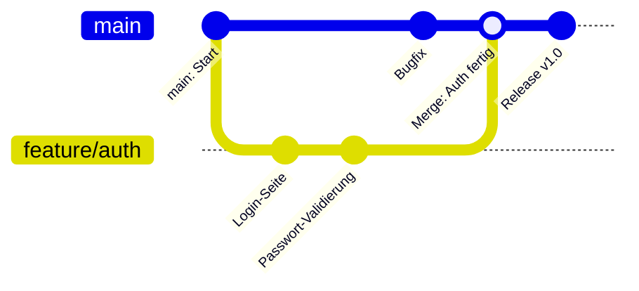
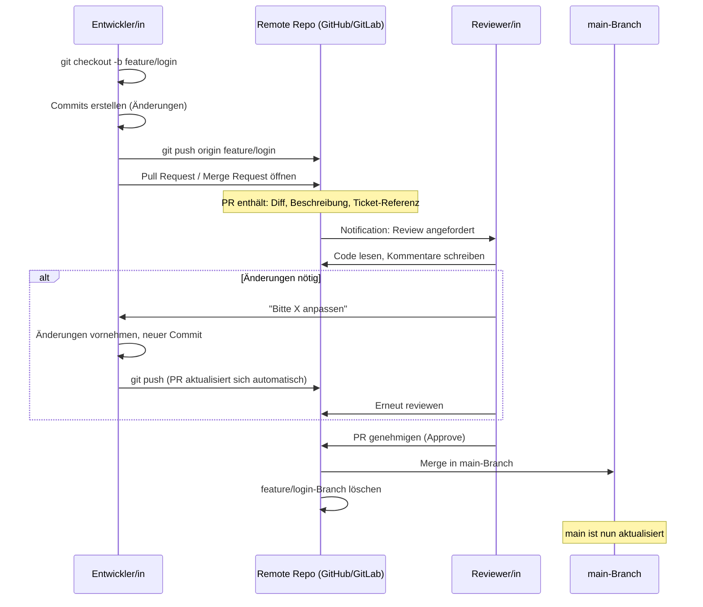
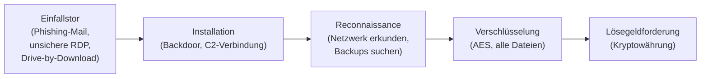
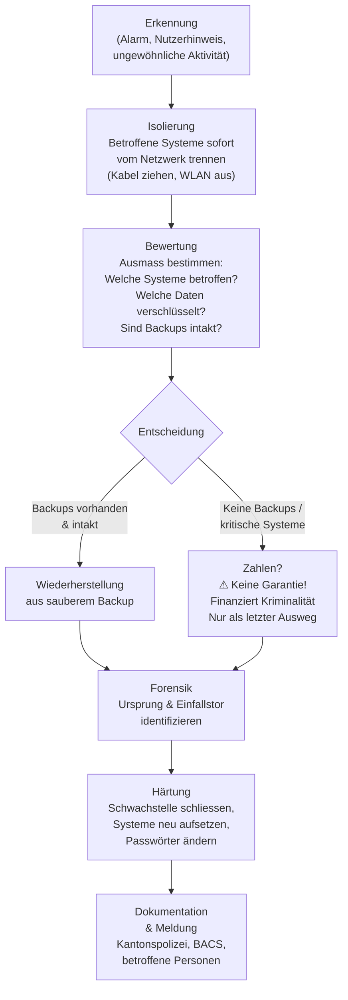
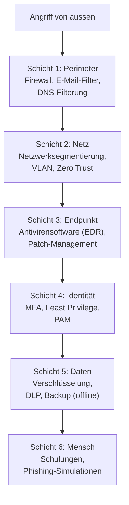
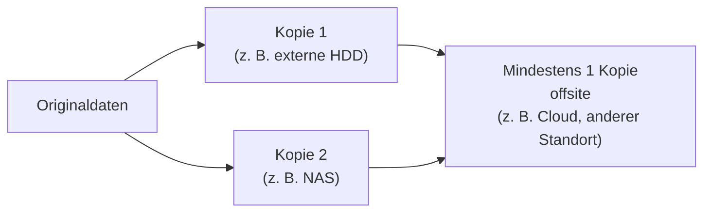
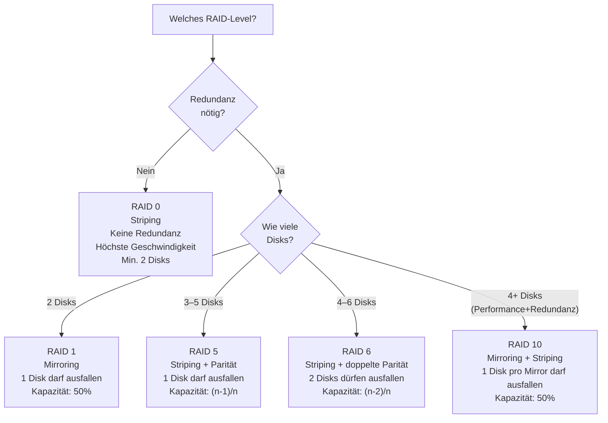

# Tag 09 - Git im Team, Ransomware, Backup & LB3-Abgabe

<details>
  <summary>
	Block: Git im Team – Versionsverwaltung, Pull Requests & Best Practices (~50')
  </summary>

## Git im Team

> 🤖 **Copilot-Agent:** [M231 T09a Git im Team](https://m365.cloud.microsoft/chat/?titleId=T_5cae40bd-d7dd-1951-0c53-e7fd3f8aba6f&source=embedded-builder) — mit dem TBZ-Konto öffnen und **Start** tippen.

### Grundlegende Git-Befehle (Repetition)

| Befehl | Bedeutung |
|---|---|
| `git clone <url>` | Repository lokal kopieren |
| `git status` | Aktuellen Zustand anzeigen |
| `git add <datei>` | Änderungen stagen |
| `git commit -m "Nachricht"` | Änderungen einschreiben |
| `git push` | Änderungen hochladen |
| `git pull` | Änderungen herunterladen |
| `git log --oneline` | Commit-History anzeigen |
| `git diff` | Änderungen seit letztem Commit anzeigen |
| `git stash` | Änderungen temporär beiseitelegen |

---

### Branches – Paralleles Arbeiten



**Warum Branches?**
- Isolierte Entwicklung neuer Features
- Kein Einfluss auf den stabilen `main`-Branch
- Paralleles Arbeiten im Team möglich

**Grundlegende Branch-Befehle:**
```bash
git checkout -b feature/mein-feature   # Branch erstellen und wechseln
git checkout main                       # Zurück zu main
git merge feature/mein-feature          # Feature einmergen
git branch -d feature/mein-feature      # Branch nach Merge löschen
```

---

### Pull Request / Merge Request – Der professionelle Workflow

Ein **Pull Request (PR)** bzw. **Merge Request (MR)** ist der standardisierte Prozess, um Code-Änderungen vor dem Merge zu prüfen (Code Review).



**Vorteile des PR-Workflows:**
- **Vier-Augen-Prinzip:** Fehler werden vor dem Merge entdeckt
- **Wissenstransfer:** Alle im Team verstehen die Änderungen
- **Nachvollziehbarkeit:** Diskussionen und Entscheidungen sind dokumentiert
- **Qualitätssicherung:** Automatische Tests (CI/CD) laufen auf dem PR

---

### Commit-Nachrichten schreiben

Eine gute Commit-Nachricht erklärt **was** geändert wurde und vor allem **warum** – nicht nur wie.

**Struktur einer guten Commit-Nachricht:**
```
<Typ>: <Kurzbeschreibung im Imperativ> (max. 72 Zeichen)

[Optionaler Beschreibungsabsatz, wenn nötig]
[Referenz auf Issue/Ticket: Fixes #42]
```

**Typen (Konvention: Conventional Commits):**
- `feat:` – Neue Funktion
- `fix:` – Fehlerbehebung
- `docs:` – Dokumentationsänderung
- `refactor:` – Umstrukturierung ohne Verhaltensänderung
- `test:` – Tests hinzugefügt oder angepasst

| Schlechte Commit-Nachricht | Gute Commit-Nachricht |
|---|---|
| `änderungen` | `fix: Passwort-Validierung akzeptiert nun Sonderzeichen` |
| `fix` | `feat: Login-Seite mit MFA-Unterstützung hinzugefügt` |
| `asdf` | `docs: README mit Installationsanleitung ergänzt` |
| `diverse Korrekturen` | `refactor: Datenbankzugriff in Repository-Klasse ausgelagert` |
| `wip` | `test: Unit-Tests für AuthService ergänzt` |

> Faustregel: Die Commit-Nachricht soll den Satz vervollständigen: «Wenn dieser Commit angewendet wird, wird er...»

---

### Merge-Konflikte

Ein Konflikt entsteht, wenn zwei Personen dieselbe Zeile einer Datei geändert haben.

```
<<<<<<< HEAD
Dies ist meine Änderung
=======
Dies ist die Änderung von Kollegin
>>>>>>> feature/andere-aenderung
```

**Auflösen:**
1. Datei öffnen, Konflikt manuell bearbeiten (gewünschten Inhalt behalten)
2. Konflikt-Marker (`<<<<<<<`, `=======`, `>>>>>>>`) entfernen
3. `git add <datei>`
4. `git commit`

---

### Best Practices für Teamarbeit mit Git

1. **Häufig committen** – kleine, logische Einheiten statt riesige Sammelpakete
2. **Aussagekräftige Commit-Nachrichten** – was wurde geändert und warum?
3. **Pull vor Push** – immer zuerst `git pull` ausführen, um Konflikte frühzeitig zu erkennen
4. **Feature Branches** – neue Funktionen immer auf einem separaten Branch entwickeln
5. **Code Review** vor dem Merge – Pull Request / Merge Request verwenden
6. **.gitignore** konsequent nutzen – keine sensiblen Daten committen (Passwörter, API-Keys, `.env`-Dateien!)
7. **Keine grossen Binärdateien** im Repository (Videos, kompilierte Artefakte)
8. **Tags für Releases** verwenden: `git tag v1.0.0`

> **Sicherheitshinweis:** Was einmal gepusht wurde, bleibt in der History – selbst nach Löschung oft noch abrufbar! Sensible Daten müssen sofort als kompromittiert betrachtet und rotiert werden.

</details>


<details>
  <summary>
	Block: Ransomware – Angriff, Incident Response & Defence in Depth (~40')
  </summary>

## Ransomware

> 🤖 **Copilot-Agent:** [M231 T09b Ransomware](https://m365.cloud.microsoft/chat/?titleId=T_408c81ce-a3b1-e630-820a-474d90ebe9a7&source=embedded-builder) — mit dem TBZ-Konto öffnen und **Start** tippen.

**Ransomware** ist Schadsoftware, die Dateien verschlüsselt und **Lösegeld** (engl. ransom) für den Entschlüsselungsschlüssel fordert.

### Ablauf eines Ransomware-Angriffs



---

### Verbreitung (Einfallstore)

| Einfallstor | Beschreibung |
|---|---|
| **Phishing-E-Mails** | Schädlicher Anhang oder Link, oft mit Social Engineering |
| **Unsichere RDP** | Remote Desktop ohne MFA, schwaches Passwort |
| **Drive-by-Download** | Schadsoftware beim Besuch einer kompromittierten Webseite |
| **Supply Chain** | Infektion über legitime Software-Updates (z. B. Kaseya VSA) |
| **USB-Sticks** | Infizierte Medien (Baiting-Angriff) |

---

### Bekannte Ransomware-Fälle

| Fall | Jahr | Schaden |
|---|---|---|
| WannaCry | 2017 | 150'000+ betroffene Systeme in 150 Ländern |
| NotPetya | 2017 | ~10 Mrd. USD Schaden (als Tarnoperation eingesetzt) |
| Colonial Pipeline | 2021 | Stilllegung der grössten US-Benzinpipeline |
| Kaseya VSA | 2021 | 1'500+ Unternehmen gleichzeitig getroffen |

---

### Incident Response Plan – Was tun im Ernstfall?



**Schritt-für-Schritt Notfallprotokoll:**

| Schritt | Massnahme | Verantwortlich |
|---|---|---|
| 1 | Betroffene Systeme **sofort** vom Netzwerk trennen | Jede Person vor Ort |
| 2 | IT-Sicherheitsverantwortliche und Vorgesetzte informieren | Entdecker/in |
| 3 | Incident dokumentieren (Zeitpunkt, betroffene Systeme) | IT-Team |
| 4 | Backup-Status prüfen: Sind Backups verschlüsselt? Offline-Backups vorhanden? | IT-Team |
| 5 | Strafanzeige erstatten (Kantonspolizei) | Geschäftsleitung |
| 6 | BACS (Bundesamt für Cybersicherheit) melden: bacs.admin.ch | IT-Team |
| 7 | Entscheid: Wiederherstellen oder zahlen (Lösegeld: letzter Ausweg) | Geschäftsleitung |
| 8 | Saubere Systeme neu aufsetzen, Backup einspielen | IT-Team |
| 9 | Einfallstor schliessen, Passwörter rotieren, Patches einspielen | IT-Team |
| 10 | Betroffene Personen informieren (Datenschutzpflicht) | Datenschutzbeauftragter |

> **Nicht zahlen** ist die offizielle Empfehlung der Behörden: Es gibt keine Garantie, dass der Schlüssel geliefert wird, und die Zahlung finanziert weitere kriminelle Aktivitäten.

---

### Schutzschichten – Defence in Depth

Defence in Depth bedeutet: **Mehrere Schutzebenen** so kombinieren, dass das Versagen einer Ebene allein keinen Totalschaden verursacht.



| Schutzschicht | Massnahmen | Schutz gegen |
|---|---|---|
| **Perimeter** | Firewall, E-Mail-Filter, Spam-Schutz | Drive-by-Downloads, Phishing |
| **Netzwerk** | Segmentierung, VLAN, Zero Trust | Laterale Bewegung im Netz |
| **Endpunkt** | EDR/Antivirus, Patch-Management | Bekannte Malware, Exploits |
| **Identität** | MFA, Least Privilege, PAM | Credential Theft, RDP-Angriffe |
| **Daten** | Verschlüsselung, offline Backup | Datenverlust, Ransomware |
| **Mensch** | Schulungen, Phishing-Simulationen | Social Engineering |

</details>


<details>
  <summary>
	Block: Backup-Konzepte & RAID (~55')
  </summary>

## Backup-Konzepte

> 🤖 **Copilot-Agent:** [M231 T09c Backup & RAID](https://m365.cloud.microsoft/chat/?titleId=T_7d3bb284-7a17-72c5-f19c-46dad599f31e&source=embedded-builder) — mit dem TBZ-Konto öffnen und **Start** tippen.

### Warum Backup?

| Ursache für Datenverlust | Häufigkeit |
|---|---|
| Hardware-Defekt (HDD/SSD) | Häufig |
| Versehentliches Löschen | Häufig |
| Ransomware | Zunehmend |
| Feuer, Wasser, Diebstahl | Selten, aber katastrophal |
| Software-Fehler / Korruption | Gelegentlich |

---

### Die 3-2-1-Backup-Regel



| Zahl | Bedeutung |
|---|---|
| **3** | Mindestens 3 Kopien der Daten |
| **2** | Auf mindestens 2 verschiedenen Medientypen |
| **1** | Mindestens 1 Kopie an einem anderen Standort (offsite) |

> **Erweiterung: 3-2-1-1-0**
> - +1 Kopie **offline/air-gapped** (Schutz vor Ransomware)
> - +0 Fehler beim letzten Restore-Test

---

### Backup-Strategien

| Strategie | Beschreibung | Vorteile | Nachteile |
|---|---|---|---|
| **Vollbackup** | Alle Daten komplett kopieren | Einfach, schnell restore | Viel Speicher, langsam |
| **Inkrementelles Backup** | Nur Änderungen seit letztem Backup | Wenig Speicher, schnell | Restore braucht alle Inkremente |
| **Differentielles Backup** | Alle Änderungen seit letztem Vollbackup | Kompromiss | Wächst täglich |

```mermaid
gantt
  title Backup-Strategien (Woche)
  dateFormat  D
  section Voll
  Vollbackup    :v1, 1, 1d
  Vollbackup    :v2, 8, 1d
  section Inkrementell
  Vollbackup    :i0, 1, 1d
  Inkrement Mo  :i1, 2, 1d
  Inkrement Di  :i2, 3, 1d
  Inkrement Mi  :i3, 4, 1d
  section Differentiell
  Vollbackup    :d0, 1, 1d
  Diff Mo       :d1, 2, 1d
  Diff Di       :d2, 3, 1d
  Diff Mi       :d3, 4, 1d
```



---

### Backup-Medien und -Orte

| Medium | Vorteile | Nachteile |
|---|---|---|
| Externe HDD/SSD | Günstig, schnell | Kann gestohlen/beschädigt werden |
| NAS (Network Attached Storage) | Automatisiert, Redundanz (RAID) | Teurer, im selben Raum |
| Cloud (Onedrive, iCloud, Backblaze) | Offsite, automatisch | Kosten, Datenschutz, Abhängigkeit |
| Bandlaufwerk (LTO) | Langlebig, günstig/GB | Langsam, spezielle Hardware |

---

### RAID – kein Ersatz für Backup

**RAID** (Redundant Array of Independent Disks) schützt vor **Hardware-Ausfall**, aber NICHT vor:
- Feuer / Diebstahl / Wasser
- Ransomware (alle verbundenen Disks werden verschlüsselt)
- Versehentlichem Löschen (Löschung repliziert sich sofort auf alle Disks)

> **Merksatz:** RAID ist **Hochverfügbarkeit**, kein Backup.

#### RAID-Level im Überblick



#### RAID-Level Vergleichstabelle

| RAID-Level | Min. Disks | Nutzbare Kapazität | Ausfall toleriert | Lese-Perf. | Schreib-Perf. | Typischer Einsatz |
|---|---:|---|---|---|---|---|
| **RAID 0** | 2 | 100% | 0 Disks | Sehr hoch | Sehr hoch | Scratch-Disks, Gaming |
| **RAID 1** | 2 | 50% | 1 Disk | Hoch | Normal | OS-Laufwerke, kleine Server |
| **RAID 5** | 3 | (n-1)/n | 1 Disk | Hoch | Mittel | Dateiserver, NAS |
| **RAID 6** | 4 | (n-2)/n | 2 Disks | Hoch | Gering | Archive, grosse NAS |
| **RAID 10** | 4 | 50% | 1 Disk/Mirror | Sehr hoch | Hoch | Datenbanken, produktive Server |

**Beispiel RAID 5 mit 4 Disks à 2 TB:**
- Nutzbare Kapazität: 3 × 2 TB = 6 TB
- 1 Disk kann ausfallen, ohne Datenverlust
- Rebuild-Zeit bei Ausfall: Stunden bis Tage (kritische Phase!)

---

### Restore-Test: Der wichtigste Teil des Backups

> Ein Backup, das nie getestet wird, ist kein Backup.

**Regel:** Regelmässig (mind. 1×/Jahr) einen **Restore-Test** durchführen:
- Können alle Daten wiederhergestellt werden?
- Wie lange dauert der Restore (RTO: Recovery Time Objective)?
- Wie viele Daten gehen maximal verloren (RPO: Recovery Point Objective)?
- Sind die Daten konsistent und vollständig?

</details>


<details>
  <summary>
	Block: LB3 Abgabe (~25')
  </summary>

## LB3 – Persönliches Dossier: Abgabe

> Abgabe heute: Link zum Git-Repository via MS-Teams Assignment – **Ende der Lektion**

### Abgabe-Checkliste (letzte Prüfung)

| Nr | Kriterium | Punkte | Erledigt? |
|---|---|---:|---|
| 1 | Git-Repository eingerichtet, README.md vorhanden, Lehrperson freigegeben | 10 P | ☐ |
| 2 | Passwortverwaltung: Vergleich + schriftliche Begründung | 4 P | ☐ |
| 3 | Passwortverwaltung installiert & Lehrperson gezeigt | 2 P | ☐ |
| 4 | Zwei Checklisten in Markdown dokumentiert | 4 P | ☐ |
| 5 | Auskunftsbegehren als PDF (Brief) im Repository (OHNE ID-Kopie!) | 2 P | ☐ |
| 6 | PGP-verschlüsselte E-Mail an Lehrperson | 2 P | ☐ |
| 7 | Lernjournal: regelmässig, Reflexion, Bezug zu HZ | 8 P | ☐ |
| 8 | MFA auf einem Konto eingerichtet & dokumentiert | 2 P | ☐ |
| 9 | Lizenzmodell für eigenes Repository gewählt & begründet | 2 P | ☐ |
| 10 | Datei/Ordner symmetrisch verschlüsselt & dokumentiert | 2 P | ☐ |
| 11 | Persönliches Ablagesystem beschrieben & angewendet | 2 P | ☐ |
| 12 | Rechtschreibung, Stringenz & Gestaltung geprüft | 10 P | ☐ |
| | **Total** | **50 P** | |

> **Realitätscheck:** Für die Abgabe sind ca. 25 Minuten dieser Lektion vorgesehen. Alles, was nicht heute fertig wird, muss vorher zu Hause erledigt werden.

---

> **Link zum Repository** bis Ende der Lektion via MS-Teams Assignment abgeben.

---

### Nach der Abgabe: Was kommt als nächstes?

| Zeitpunkt | Was passiert |
|---|---|
| **Heute (Tag 9, Ende Lektion)** | LB3 abgegeben – kein Nachbessern mehr möglich |
| **Bis Tag 10 (zu Hause)** | Spick für LB2 fertigstellen (1 A4-Blatt, doppelseitig, persönlich) |
| **Tag 10** | Theorie-Repetition, dann LB2-Prüfung (40 min), danach Modulabschluss |
| **Nach Tag 10** | Noteneingabe durch Lehrperson |

**Empfehlung für die Zusammenfassung (Spickzettel für LB2):**
- Nicht zu viel Text – Stichwörter, Tabellen, Diagramme
- Strukturiert nach Themenblöcken (Lizenzmodelle, Privacy, CIA, Risiko, Backup, Ransomware, …)
- Eigene Beispiele eintragen – erleichtert das Erinnern unter Prüfungsdruck

---

### Lernjournal-Eintrag Tag 9

Halten Sie fest: Was haben Sie heute gelernt (Git im Team, Ransomware, Backup)? Wie fühlen Sie sich nach der LB3-Abgabe? Wie gut fühlen Sie sich auf LB2 vorbereitet (Skala 1–5)?

</details>
