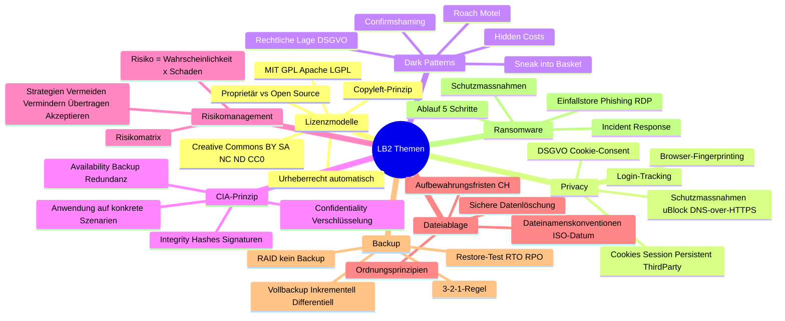
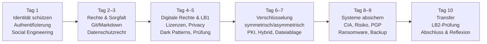

# Tag 10 - LB2 Theorieprüfung & Modulabschluss

  

	Block: Repetition & Prüfungsvorbereitung LB2 (~50')
  

## LB2 – Prüfungsvorbereitung

### Themenübersicht LB2

---

### Repetitions-Karten – Die wichtigsten Fakten je Thema

**Lizenzmodelle & Urheberrecht**
| Punkt | Merksatz |
|---|---|
| Urheberrecht | Entsteht automatisch bei Schöpfung – keine Anmeldung nötig |
| GPL (Copyleft) | Wer GPL-Code nutzt, muss eigenen Code auch unter GPL veröffentlichen |
| MIT | Freizügig: Nutzen, verändern, verkaufen erlaubt – nur Copyright-Hinweis behalten |
| Creative Commons | CC BY = Namensnennung; SA = ShareAlike; NC = Non-Commercial; ND = No Derivatives |

**Privacy-Threats & Dark Patterns**
| Punkt | Merksatz |
|---|---|
| Third-Party-Cookie | Gesetzt von fremder Domain – ermöglicht websiteübergreifendes Tracking |
| Fingerprinting | Keine Cookies nötig: Browser-Eigenschaften identifizieren Nutzer eindeutig |
| DSGVO-Pflicht | Cookie-Consent braucht echte Wahlmöglichkeit (kein Pre-Ticked, kein Dark Pattern) |
| Roach Motel | Leicht rein, schwer raus (z. B. Abo kündigen ist sehr aufwändig) |
| Confirmshaming | Ablehnen-Button beschämt: «Nein, ich will keine Rabatte» |

**CIA-Prinzip & Risikomanagement**
| Punkt | Merksatz |
|---|---|
| Confidentiality | Verschlüsselung, MFA, Zugriffskontrollen – schützt vor Datenleck, Abhören |
| Integrity | SHA-256-Hash, digitale Signatur – schützt vor Manipulation, Korruption |
| Availability | 3-2-1-Backup, RAID, Redundanz – schützt vor Ransomware, DDoS, Ausfall |
| Risikobewertung | Risiko = Eintrittswahrscheinlichkeit × Schadensausmass |
| 4 Strategien | Vermeiden / Vermindern / Übertragen / Akzeptieren |

**Dateiablage & Backup**
| Punkt | Merksatz |
|---|---|
| ISO-Datum | YYYY-MM-DD – garantiert alphabetische = chronologische Sortierung |
| Aufbewahrung | Buchungsbelege CH: 10 Jahre (Obligationenrecht Art. 958f) |
| 3-2-1-Regel | 3 Kopien, 2 Medientypen, 1 offsite |
| RAID ≠ Backup | Schützt vor Disk-Ausfall, nicht vor Ransomware/Feuer/Löschen |

**Ransomware**
| Punkt | Merksatz |
|---|---|
| Häufigster Einfallstor | Phishing-E-Mail mit Anhang oder Link |
| Ablauf | Einfallstor → Backdoor → Reconnaissance → Verschlüsselung → Forderung |
| Wichtigste Schutzmassnahme | Offline-Backup (nicht erreichbar für Ransomware) |
| Im Ernstfall | Isolieren, nicht zahlen, melden (BACS), Forensik |

---

### Selbsttest: 5 Fragen pro Themenblock

> Sozialform: Einzelarbeit (10min still beantworten), dann Q&A im Plenum
> Dauer: 25min

**Block A – Lizenzen & Privacy**
1. Was bedeutet «Copyleft» bei der GPL-Lizenz?
2. Darf man ein Bild mit CC BY-NC-Lizenz auf einer kommerziellen Website verwenden?
3. Was ist Browser-Fingerprinting und warum schützen Cookie-Einstellungen allein nicht davor?
4. Nennen Sie zwei Dark Patterns und erklären Sie deren Wirkung.
5. Was ist der Unterschied zwischen First-Party- und Third-Party-Cookie?

**Block B – CIA & Risiko**
1. Nennen Sie je eine technische Massnahme für C, I und A.
2. Ein Angreifer verändert Kontostand-Daten in einer Datenbank. Welches CIA-Ziel ist verletzt?
3. Wie berechnen Sie den Risikowert eines IT-Risikos?
4. Was ist der Unterschied zwischen «Risiko übertragen» und «Risiko akzeptieren»?
5. Warum reicht ein einzelner Virenscanner nicht aus (Defence in Depth)?

**Block C – Dateiablage & Backup**
1. Erklären Sie die 3-2-1-Backup-Regel in einem Satz.
2. Was ist der Vorteil des differenziellen Backups gegenüber dem inkrementellen beim Restore?
3. Warum schützt RAID 1 nicht vor Ransomware?
4. Was versteht man unter RTO und RPO?
5. Welche Ergänzung fügt die 3-2-1-1-0-Regel hinzu?

**Block D – Ransomware**
1. Nennen Sie drei häufige Einfallstore für Ransomware.
2. Was soll man im Ernstfall als erstes tun, wenn man eine Ransomware-Infektion bemerkt?
3. Nennen Sie zwei bekannte Ransomware-Fälle und deren Auswirkung.
4. Was ist «Defence in Depth»?
5. Warum ist «zahlen» keine empfohlene Strategie?

---

### Q&A – Offene Fragen

> Sozialform: Plenum
> Dauer: 10 min

Stellen Sie Ihre letzten Fragen. Die Lehrperson klärt Unklarheiten vor der Prüfung.

  

	Block: LB2 Theorieprüfung (~40')
  

## LB2 – Theorieprüfung 2

| | |
|---|---|
| **Dauer** | 40 Minuten, 33 Fragen |
| **Format** | Computer, Safe Exam Browser (SEB) – Moodle, Multiple Choice |
| **Erlaubte Hilfsmittel** | Persönlicher Spick: 1 A4-Blatt, doppelseitig, selbst erstellt |
| **Elektronische Geräte** | Nicht erlaubt (Laptop, Tablet, Smartphone) |
| **Spick** | Muss mit der Prüfung abgegeben werden |

> **Wichtige Erinnerung:** Der Spick wird mit abgegeben und nicht benotet – er dient nur als erlaubtes Hilfsmittel. Bitte Name und Klasse draufschreiben.

**Prüfungsinhalt (Schwerpunkt Tag 6–8, plus Repetition Tag 1–4):**
- Symmetrische Verschlüsselung & Häufigkeitsanalyse
- Asymmetrische Verschlüsselung, Hybrid, PGP & GPG-Praxis
- CIA-Prinzip & Risikomanagement
- Dateiablagesysteme & Ordnungsprinzipien, Aufbewahrungsfristen, sichere Datenlöschung
- Grundlagen Backup (3-2-1-Regel, RAID) & Ransomware
- Repetition: Authentifizierung & Passwörter, Datenschutzrecht & Anonymität, Lizenzen, Privacy-Threats, Dark Patterns

Lernziele im Detail: **[LBs/LB2/lb2-lernziele.md](lbs/lb2/lb2-lernziele.md)**

**Kompetenzbezug:** HZ 1.1–1.4, 2.1, 2.2, 2.3, 2.4, 3.1, 4.1, 5.1, 5.2, 6.1

  

	Block: Modulabschluss, Reflexion & KI-Rückblick (~55')
  

## Modulabschluss

### Kompetenzreise durch das Modul

---

### Rückblick: Was haben wir gelernt?

| Tag | Thema | Kern-Kompetenz |
|---|---|---|
| 1 | Modulstart, Authentifizierung & Autorisierung, Social Engineering | Eigene Identität digital schützen |
| 2 | Git/Markdown, Datenschutzrecht (DSG/DSGVO), Arbeit am Lernjournal | Rechtliche Grundlagen kennen |
| 3 | CIA-Triade, Datenschutz vs. Datensicherheit, Online-Anonymität | Risiken im digitalen Alltag einschätzen |
| 4 | Lizenzmodelle, Privacy-Threats, Dark Patterns | Digitale Rechte einschätzen |
| 5 | LB1 Theorieprüfung (Stoff Tag 1–4, Vorbereitung im Selbststudium) | Wissen anwenden |
| 6 | Checklisten DSB, symmetrische Verschlüsselung, Häufigkeitsanalyse | Verschlüsselung verstehen |
| 7 | Asymmetrische Verschlüsselung, PKI, Dateiablagesysteme | Verschlüsselung anwenden |
| 8 | CIA-Prinzip, Risikomanagement, PGP | Systeme bewerten und absichern |
| 9 | Git im Team, Ransomware, Backup, LB3-Abgabe | Daten sichern |
| 10 | LB2 Theorieprüfung, Abschluss | Transfer und Reflexion |

---

### Selbsteinschätzung: Handlungsziele

Die Selbsteinschätzung zu den Handlungszielen erfolgt über ein **MS-Forms-Formular** (Link von der Lehrperson). Sie ist nicht Teil von LB3, muss nicht im Lernjournal dokumentiert werden und wird **nicht bewertet**.

---

### Persönliche Reflexion (Lernjournal-Abschlusseintrag)

> Sozialform: Einzelarbeit
> Dauer: 15 min
> Abgabe: Lernjournal (letzter Eintrag)

Beantworten Sie im Lernjournal:

1. **Was waren meine wichtigsten Lernerfolge in diesem Modul?** (Nenne mindestens 3 konkrete Inhalte)
2. **Welche Inhalte fand ich am schwierigsten – und wie habe ich damit umgegangen?**
3. **Wie hat sich mein Bewusstsein für Datenschutz und Datensicherheit verändert?** (Vergleich: Tag 1 vs. heute)
4. **Was nehme ich aus diesem Modul konkret in meinen Berufsalltag mit?** (Nenne mindestens 2 konkrete Massnahmen)
5. **KI-Rückblick (optional, nicht bewertet):** An welchen Stellen im Modul hat Ihnen KI als Lernpartner geholfen (z. B. Tag 1, 3, 4 oder 5)? Wo lag sie falsch oder war weniger hilfreich als erwartet? Was nehmen Sie sich für den künftigen Umgang mit KI-Werkzeugen vor?

---

### Datenschutz im Berufsalltag als Informatiker/in

Als Informatiker/in oder Informatikerin haben Sie eine besondere Verantwortung: Sie gestalten Systeme, die Daten verarbeiten. Checkliste für die Praxis:

**Bei der Software-Entwicklung:**
- [ ] Keine Passwörter, API-Keys oder persönliche Daten im Git-Repository committen
- [ ] Personendaten nur so lange speichern, wie nötig (Datensparsamkeit)
- [ ] Zugriffskontrolle: Least Privilege – Nutzer erhalten nur die Rechte, die sie brauchen
- [ ] Eingaben immer validieren (Injection-Angriffe vermeiden)
- [ ] HTTPS überall: Kein HTTP für Seiten mit persönlichen Daten

**Bei der System-Administration:**
- [ ] Regelmässige Patches und Updates einspielen
- [ ] MFA für alle Administrator-Konten aktivieren
- [ ] Backup-Konzept dokumentieren und Restore-Test jährlich durchführen
- [ ] Netzwerksegmentierung: Produktive Systeme von Büro-Netzwerk trennen
- [ ] Logs aufzeichnen und auswerten (Anomalien erkennen)

**Im Alltag:**
- [ ] Passwortmanager verwenden, starke einzigartige Passwörter pro Dienst
- [ ] MFA wo immer möglich aktivieren
- [ ] Software-Updates zeitnah einspielen
- [ ] Misstrauisch bei E-Mails mit Anhängen oder Links (Phishing)
- [ ] Regelmässig prüfen: haveibeenpwned.com – eigene E-Mail-Adresse kompromittiert?
- [ ] KI-Werkzeuge nur mit Nutzungsrahmen und Faktencheck einsetzen (vgl. Tag 1, 3, 4, 5)

---

### Weiterführende Ressourcen

| Ressource | Beschreibung | URL |
|---|---|---|
| **EDÖB** | Eidgenössischer Datenschutz- und Öffentlichkeitsbeauftragter | edoeb.admin.ch |
| **BACS** | Bundesamt für Cybersicherheit – Meldestelle, Informationen | bacs.admin.ch |
| **OWASP** | Open Web Application Security Project – Top 10 Web-Sicherheitsrisiken | owasp.org |
| **Have I Been Pwned** | Prüfen, ob eigene E-Mail-Adresse in Datenlecks aufgetaucht ist | haveibeenpwned.com |
| **BSI** | Deutsches Bundesamt für Sicherheit in der Informationstechnik | bsi.bund.de |
| **Heise Security** | Sicherheitsnews auf Deutsch | heise.de/security |
| **EFF** | Electronic Frontier Foundation – Digitale Rechte & Privatsphäre | eff.org |

---

### Ausblick

Datenschutz und Datensicherheit sind keine einmaligen Themen, sondern **lebenslange Kompetenzen**:
- Gesetze ändern sich (nächste DSG-Revision, EU AI Act, Cyber Resilience Act)
- Bedrohungen entwickeln sich weiter (KI-generiertes Phishing, Deepfakes, neue Ransomware-Varianten)
- Technische Massnahmen müssen regelmässig überprüft und angepasst werden
- KI-Werkzeuge selbst verändern sich laufend – der reflektierte, faktengeprüfte Umgang damit (wie in diesem Modul geübt) bleibt eine Kernkompetenz

> Bleiben Sie neugierig – und kritisch. Wer Systeme baut, trägt Verantwortung für die Menschen, die sie benutzen.

